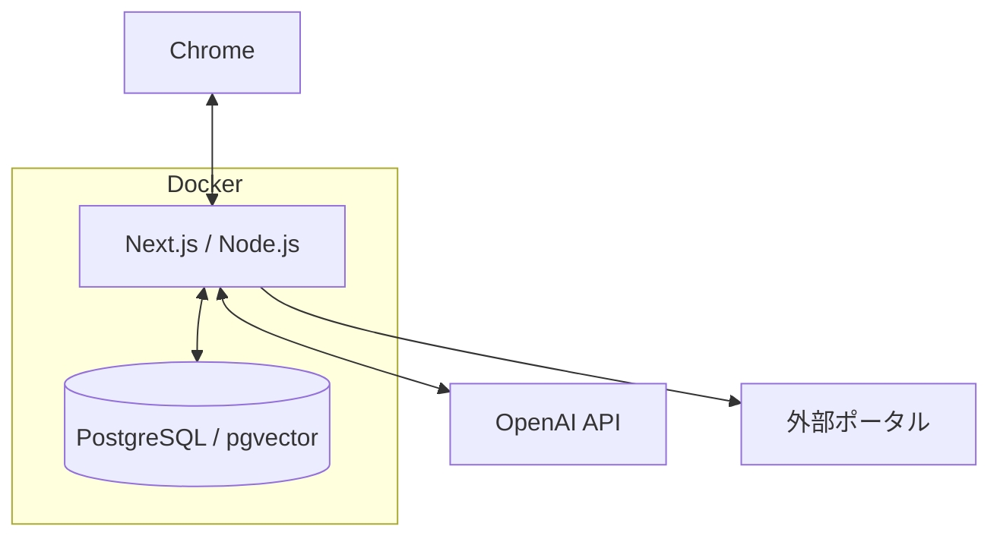
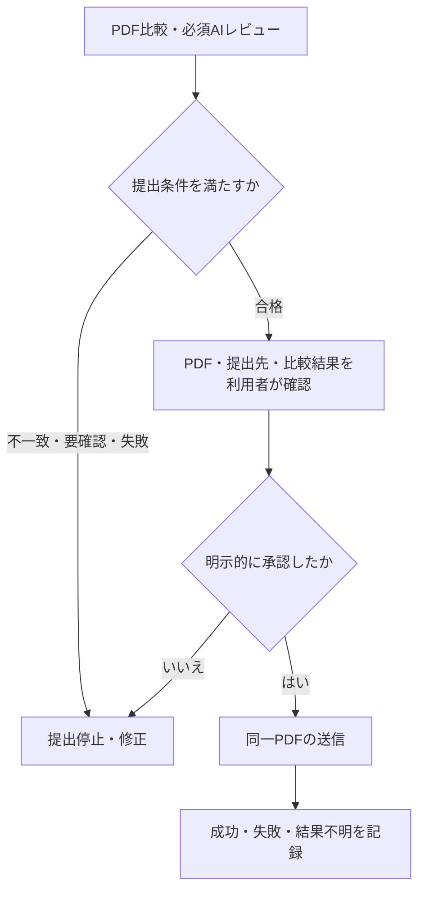
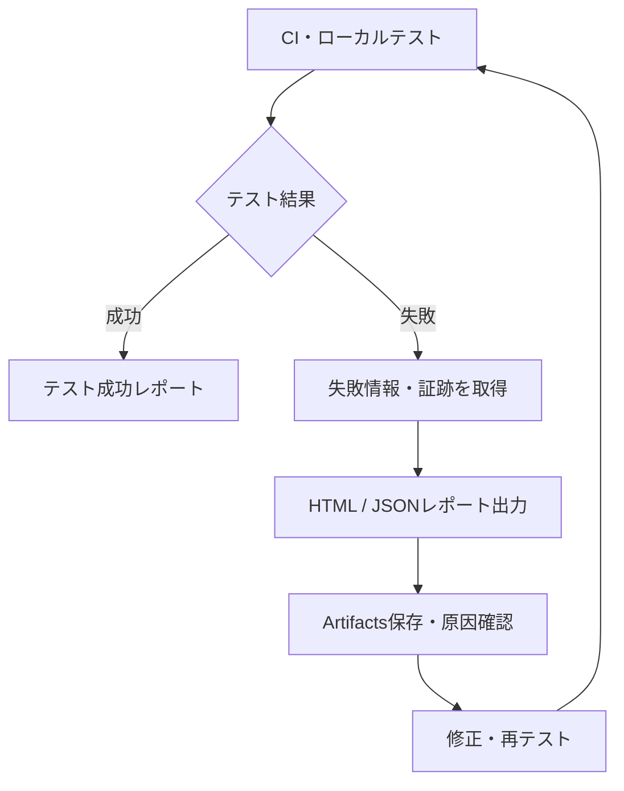

> **このファイルの用途：** Next.jsを中核にした月次作業報告書PDF比較アプリの目的、構成、Windows＋WSL2＋Docker Desktop環境構築、GitHub／SourceTree連携・ブランチ運用、テスト手順、制限事項および追加開発の設計方針を説明します。
>
> **対象：** 自己学習・ポートフォリオ用MVP。業務運用前には実際の帳票レイアウト・送信許可・セキュリティの追加検証が必要です。

# ReportDiff AI — 月次作業報告書 AI差分チェックシステム

**プロジェクト名：** `ReportDiff AI`（ディレクトリ名・npmパッケージ名：`report-diff-ai`）

「**正本PDFを基準**」に、比較対象PDFの稼働時間・作業日数・担当者・案件・本文を照合するWebアプリケーションです。数値や日付は**プログラムで厳密比較**し、作業内容の言い換えなどの意味的な違いは**RAGで根拠を検索した上でLLMが補足分析**します。

- **Next.js 16 App Router** / React 19 / TypeScript / Node.js 24
- **npm**で依存関係を管理（Yarnは使用しない）
- **LLM＋RAGは必須**。設定不足や通信エラー時に「比較完了」と表示しない
- **Docker Desktop＋WSL2＋Linuxコンテナ**で開発し、**GitHub＋SourceTree**で履歴・ブランチを管理する
- ソースコードの**先頭に日本語で用途を記述**し、主要な関数にもコメントを記述
- **追加採用方針（2026-11-17）：** Tailwind CSS、PostgreSQL＋pgvector、OpenAI Codex、Vitest、Playwright、GitHub Actions。外部サイトへの提出支援と不具合レポート自動出力を計画する（詳細は第11章以降）。

> 本READMEの追加開発方針は、既存のMVPへの実装完了を意味しません。第1〜10章は既存の実装を基準とし、第11〜16章は今後の実装計画、第17章は技術選定の意図です。

## 1. 実装済み機能と開発状況

| 項目                                                       | 実装             | 検証状況                                                            |
| ---------------------------------------------------------- | ---------------- | ------------------------------------------------------------------- |
| 正本・比較対象PDFのアップロード                            | 済               | HTTP経由の実行は未検証                                              |
| PDFテキスト抽出（unpdf、ページ番号保持）                   | 済               | 実PDF読込テストを追加・実行待ち                                     |
| 対象年月・作業者・案件・作業日数・稼働時間・残業時間の比較 | 済               | 単体テスト成功                                                      |
| 同月比較 / 異月比較                                        | 済               | 単体テスト成功                                                      |
| 本文の行差分・PDFプレビュー                                | 済               | ブラウザーE2Eは未検証                                               |
| Embedding＋コサイン類似度のRAG検索                         | 済               | 純粋関数テスト成功、実API未検証                                     |
| OpenAI Responses APIによるLLMレビュー                      | 済               | 応答検証テスト成功、実API未検証                                     |
| Docker開発環境（Dockerfile.dev / compose.yaml）            | 設定あり         | ユーザーのWSL2環境でNext.js開発サーバー起動ログを確認（2026-11-09） |
| PostgreSQL / pgvector、OCR、日別明細、ログイン             | 未実装           | —                                                                   |
| Tailwind CSSによるUI刷新                                   | 採用予定・未実装 | —                                                                   |
| 外部ポータルへのPDF提出連携                                | 計画・未実装     | API・画面仕様・利用許可の確認が必要                                 |
| CodexによるPRレビュー / GitHub ActionsによるCI             | 採用予定・未設定 | —                                                                   |
| Vitest / Playwright / 不具合レポート自動出力               | 採用予定・未実装 | —                                                                   |

**現在はMVPの開発段階です。** 作成時の自動テスト19件は成功しました。その後、ユーザーのWindows 11＋WSL2環境でNext.js 16.4.5の開発サーバー起動ログを確認しています。ただし、**Next.jsの本番ビルド・OpenAI API実通信・型チェックの最終的な成功は未確認**です。2026-11-09には`lib/pdf.ts`の`PDFDocumentProxy.destroy()`に関する型エラーが報告されており、修正後の再確認が必要です。初期時点の検証結果は[`docs/TEST_REPORT.md`](docs/TEST_REPORT.md)に記載しています。

## 2. アーキテクチャ

```text
ブラウザー（Next.js Client Component）
    ├── 正本PDF（source）
    └── 比較対象PDF（target）
             │ FormData
             ▼
Next.js Route Handler: POST /api/compare (Node.js Runtime)
             ▼
    lib/pdf.ts: unpdfによるページ別テキスト抽出
             ▼
    lib/compare-flow.ts: オーケストレーション
          ├── lib/compare.ts: 数値・日付・本文のルール比較
          └── lib/rag.ts: チャンク分割・Embedding・関連文検索
                   ├── lib/rag-core.ts: 類似度とランキング（テスト可能）
                   └── lib/llm.ts: Responses API / Structured Outputs
                            ▼
                   lib/ai-guard.ts: 根拠ID・形式の検証
             ▼
 Reactへ比較結果JSONを返す（AIエラーならHTTP 502）
```

**RAGは何をしている？** 両PDFの抽出テキストをページごとに約700文字で分割し、Embedding APIへ送信してベクトル化します。比較結果に関する検索文と各チャンクの**コサイン類似度**を計算し、正本・対象からそれぞれ上位5件を選びます。LLMはそれらとルール比較結果をもとに日本語で説明します。

- 今回のRAGは**メモリ上の検索**です。PostgreSQL/pgvectorへの永続保存は未実装です。
- チャンクはPDF全体を作成します（従来の先頭50件制限を撤廃）。ただし**検索結果は各5件**のため、すべての差分の発見を保証するものではありません。
- 極端な長文（1文書400チャンク超）は黙って一部を省略せず、エラーにします。
- ファイルはサーバーに永続保存しません。Embedding/LLMへの送信内容・APIの保持規定は別途確認してください。

詳しい技術選定と流れは [`docs/ARCHITECTURE.md`](docs/ARCHITECTURE.md)、ファイルごとの役割は [`docs/FILE_PURPOSES.md`](docs/FILE_PURPOSES.md) を参照してください。**旧版の`README-docker-wsl2.md`とは併用せず、このREADMEの環境構築手順を正とします。**

## 3. Windows 11 + WSL2 + Docker Desktopの構築手順

### 3-1. 事前条件

- Windows 11、BIOS/UEFIで仮想化が有効なPC
- インターネット接続、管理者権限
- Docker Desktop（Windows版）、Visual Studio Code + WSL拡張（推奨）
- OpenAI APIキー（**ChatGPT Plus等とは別契約・従量課金**）

### 3-2. WSL2 / Ubuntuのインストール【Windows PowerShell 管理者】

```powershell
# Ubuntuを導入（インストール済みなら不要）
wsl --install -d Ubuntu
# WSLを更新
wsl --update
# UbuntuがVERSION 2で動いているか確認
wsl --list --verbose
```

必要なら再起動し、Ubuntu初回起動でLinuxユーザーを設定します。`VERSION 1`なら `wsl --set-version Ubuntu 2` を実行します。

### 3-3. Docker Desktopの導入【Windows】

1. [Docker Desktop公式サイト](https://www.docker.com/products/docker-desktop/)からインストールします。
2. Docker Desktopを起動し、`Settings > General > Use WSL 2 based engine`を有効にします（自動設定済みの場合は表示されないこともあります）。
3. `Settings > Resources > WSL Integration`で**Ubuntu**を有効にし、適用・再起動します。
4. **Linuxコンテナモード**であることを確認します。Ubuntu内にDocker Engineを二重インストールする必要はありません。

公式ガイド: [Docker Desktop on WSL2](https://docs.docker.com/desktop/features/wsl/)

### 3-4. Docker起動の確認【Windows PowerShell → Ubuntuターミナル】

```powershell
# Windows側
docker --version
docker compose version
docker run --rm hello-world
```

```bash
# Ubuntu側（WSL Integrationの確認）
docker version
docker compose version
```

`docker version`がClientとServerの両方を出力できればDockerに接続できています。

### 3-5. ソースコードの配置【Ubuntuターミナル】

ReportDiff AIのソースコードは、**Ubuntu内の** `/home/ists/projects/report-diff-ai` に配置します。Linux側のファイルシステムを使うと、Next.jsのファイル監視やコンテナとのファイル共有が安定しやすくなります。

GitHubにソースコードが登録済みで、Ubuntuに開発用ディレクトリがまだ存在しない場合は、Gitの導入・SSH認証（第4章参照）の後、次の手順でクローンします。

```bash
mkdir -p ~/projects
cd ~/projects
git clone git@github.com:adt718/report-diff-ai.git
```

すでに開発用ソースが存在する場合はクローンを行わず、既存のディレクトリを使用してください。以降は共通の手順です。

```bash
# プロジェクトルートを開く
cd ~/projects/report-diff-ai

# 必要な設定ファイルを確認
ls -l README.md package.json compose.yaml Dockerfile.dev

# VS Code（WSL拡張がある場合）で開く
code .
```

Windowsエクスプローラーから編集する場合は、`\\wsl$\Ubuntu\home\ists\projects\report-diff-ai`で開くこともできます。ただし、開発時はVS CodeのWSL拡張で開く方法を推奨します。

### 3-6. OpenAIの環境変数

```bash
cp .env.example .env.local
nano .env.local
```

`.env.local`の例：

```dotenv
OPENAI_API_KEY=実際のAPIキー
OPENAI_MODEL=gpt-4.1-mini
OPENAI_EMBEDDING_MODEL=text-embedding-3-small
```

`.env.local`はGit追跡対象外です。APIキーをチャット・README・Gitへ転載しないでください。利用可能なLLMモデルIDは契約とプロジェクト設定により異なるため、必要なら `OPENAI_MODEL` を変更してください。

### 3-6a. npmとNext.jsのインストールについて（重要）

**このプロジェクトは新規作成済みのNext.jsアプリです。** `package.json` の `dependencies` に `next`・`react`・`react-dom` が登録されています。そのため、**`npx create-next-app` や `npm install next` を別途実行する必要はありません**。

**Dockerを使用する場合（本プロジェクトの推奨構成）：**

- `Dockerfile.dev` の `FROM node:24-bookworm-slim` が **Node.js 24とnpm** を含む環境を用意します。
- 同ファイルの `RUN npm install`（ロックファイルがあれば `npm ci`）が **Next.js・Reactなどを一括インストール**します。
- UbuntuやWindowsにNode.js・npmを別途インストールする必要はありません。

```bash
# 下記3-7の起動コマンドで、必要なパッケージもDockerイメージへインストールされる
docker compose up --build -d

# 起動後のバージョン確認（ホストではなくコンテナ内で実行）
docker compose exec app node --version
docker compose exec app npm --version
docker compose exec app npm ls next react react-dom
```

`docker compose` は `.env.local` を読み込むため、**先に3-6の手順でファイルを作成**してください。`npm ls`でNext.js等のバージョンが表示されれば、依存関係がインストールされています。

**Dockerを使わない場合：** UbuntuまたはWindowsに **Node.js 24** をインストールした後、プロジェクトのルートで次を実行します。

```bash
node --version
npm --version
npm install                # package.jsonのNext.js・React等をまとめてインストール
npm ls next react react-dom
npm run dev                # http://localhost:3000
```

> **補足：** `npm install next react react-dom` は _依存関係がまだない別のプロジェクト_ にNext.jsを追加する場合のコマンドです。ReportDiff AIでは登録済みなので実行不要です。また、`npx create-next-app@latest` は**新規プロジェクトを作るコマンド**であり、既存の `report-diff-ai` フォルダーでは実行しません。

### 3-7. DockerでNext.jsを起動【Ubuntuターミナル】

```bash
# Compose構成の検証（ファイルが読めるか確認）
docker compose config --quiet

# 初回ビルド・起動
docker compose up --build -d

# Next.jsの起動ログ（Readyを確認）
docker compose logs -f app
```

Windowsのブラウザーで **http://localhost:3000** を開きます。ブラウザーから `sample/report_source.pdf`（160時間）と `sample/report_target.pdf`（152時間）を選択します。**実際の比較ボタンを押すとOpenAI APIに通信し、API料金が発生します**。

UbuntuからWindows版Chromeを直接開く場合は、起動ログで `Ready` を確認した後、別のUbuntuターミナルで実行します（ChromeがWindowsにインストール済みでWSLの相互運用が有効であること）。

```bash
cmd.exe /C start chrome http://localhost:3000
```

### 3-8. package-lock.jsonの作成と依存関係の固定（重要）

**`package-lock.json` がGitHubで管理されている場合は、そのファイルを使用してください。** まだ生成されていない場合のみ、初回起動後に次の操作でホストのプロジェクトにも生成します。

```bash
# コンテナでlockfileを生成してUbuntu側のソースディレクトリへ保存
docker compose exec app npm install --package-lock-only

# 完成したlockfileを使うnpm ciビルドへ切り替え
docker compose up -d --build

# package-lock.jsonができたことを確認
ls -lh package-lock.json
```

**`package-lock.json`はGitにコミット**し、以後は`npm ci`で依存バージョンを固定します。`package.json`を変更したら`npm install`でlockfileを更新します。

### 3-9. Dockerコンテナから各種テストを実行

```bash
# 比較ロジック・RAG純粋関数・AI応答検証・疑似結合テスト
docker compose exec app npm run test:core

# 実物のサンプルPDFをunpdfで解析（OpenAI APIには接続しない）
docker compose exec app npm run test:pdf

# TypeScript型チェック
docker compose exec app npm run typecheck
```

**実APIスモークテスト（有料）**：アプリが起動し、`.env.local`を設定した後に実行します。結果の概要・正本側根拠・比較側根拠、160時間と152時間の差分を確認します。

```bash
docker compose exec app npm run test:smoke
```

Next.jsの本番ビルドは、開発サーバーと`.next`ディレクトリの競合を避けるため別実行にします。

```bash
docker compose stop app
docker compose run --rm --no-deps app npm run build
docker compose up -d
```

### 3-10. 停止・再起動

```bash
docker compose down           # 停止。named volumeは残る
docker compose up -d          # 再起動
docker compose logs -f app    # ログ確認
# docker compose down -v はnode_modules等を消すので注意（DB導入後はDBデータも削除し得る）
```

## 4. Git / GitHub / SourceTreeの連携とブランチ運用

> **この章の用途：** Ubuntu（WSL2）の同一ソースコードをVS Code・Docker・Windows版SourceTreeで利用し、GitHubとの同期、コミット、`main` / `develop` の運用を行う。作業フォルダーは移動しない。

### 4-1. 開発場所とGit操作の役割

| 環境                    | 使い方                                                                        |
| ----------------------- | ----------------------------------------------------------------------------- |
| Ubuntu（WSL2）          | `/home/ists/projects/report-diff-ai` に**唯一の開発用ソース**と `.git` を配置 |
| VS Code（WSL）          | 同じディレクトリでコード編集                                                  |
| Docker Desktop + Ubuntu | 同じディレクトリで `docker compose` を実行                                    |
| SourceTree（Windows）   | WSLの**既存リポジトリ**を開き、コミット・Push・Pull・ブランチ操作             |
| GitHub                  | `adt718/report-diff-ai` をリモートリポジトリ（`origin`）として使用            |

- 開発用ソースはUbuntu側のディレクトリに一元化し、複数の作業コピーを混在させないでください。
- **SourceTreeからWSLフォルダーを開くことはGitHubへの「リモート接続」ではありません。** GitHubへの通信が必要なのはPush・Pull・Fetchです。
- Windows版SourceTreeによるWSLのファイル操作は、環境によって遅延・権限・改行コードの問題が生じます。問題がある場合はUbuntuの `git` CLIを利用します。

### 4-2. Gitの導入と初期化【Ubuntu】

```bash
cd /home/ists/projects/report-diff-ai

# Gitの確認。なければ sudo apt update && sudo apt install -y git
git --version

# 既存のGit管理状態を確認
git status
```

`fatal: not a git repository` の場合だけ、**このディレクトリで**次を実行します。

```bash
git init -b main
```

Gitのコミット作成者情報が未設定なら、Ubuntuで設定します（実際の名前・GitHubで利用するメールアドレスに変更）。

```bash
git config --global user.name "YOUR_NAME"
git config --global user.email "YOUR_GITHUB_EMAIL"
```

SourceTree（Windows版Git）でコミットする場合は、Windows側のGitにもコミット作成者情報を設定してください。GitHubのログイン認証とコミット作成者情報は別物です。

### 4-3. GitHubに新規リポジトリを作る【ブラウザー】

[GitHubの新規リポジトリ作成画面](https://github.com/new) を開き、Repository nameを **`report-diff-ai`** にします。まずはPrivate推奨です。ローカルにREADMEや`.gitignore`があるため、GitHub側のREADME、`.gitignore`、Licenseの自動追加は選択しません。

GitHub上でリポジトリを作成しただけでは、Ubuntuのファイルは自動アップロードされません。

### 4-4. SSH認証とリモート設定【Ubuntu】

Ubuntuで作成済みの公開鍵がGitHubに登録されているか確認します。秘密鍵（`~/.ssh/id_ed25519`）は共有・Git登録しません。

```bash
# 公開鍵の所在を確認
ls -l ~/.ssh/id_ed25519.pub

# GitHubへのSSH認証確認
ssh -T git@github.com
```

`Hi adt718! You've successfully authenticated...` と表示されたら、Ubuntu側の認証成功です。初回接続時はホスト鍵のフィンガープリントを[GitHub公式情報](https://docs.github.com/en/authentication/connecting-to-github-with-ssh/testing-your-ssh-connection)と照合してから許可します。

```bash
cd /home/ists/projects/report-diff-ai
# 登録済みのリモートを確認
git remote -v

# originが存在しないときだけ実行
git remote add origin git@github.com:adt718/report-diff-ai.git

# originが存在していてURLを直す場合は「add」ではなく次を利用
# git remote set-url origin git@github.com:adt718/report-diff-ai.git
```

**重要：** Ubuntuで成功したSSH認証は、Windows版SourceTreeには自動共有されません。SourceTreeでPush・Pullする場合は、Windows側にも認証設定が必要です。SSH方式を維持するならWindows用のSSH鍵を別途作成し、GitHubに**公開鍵だけ**を登録して、SourceTreeのSSHクライアント設定を確認します。HTTPS/OAuth方式へ変更することも可能ですが、同じ`.git/config`を利用しているため`origin`のURL変更はUbuntu側にも反映されます。

### 4-5. SourceTreeにUbuntu上のリポジトリを登録【Windows】

1. WindowsでSourceTreeを起動します。
2. **「クローン」ではなく、「Add / Add Existing Local Repository（既存の作業コピーを追加）」**を選びます。
3. 次の**WindowsのUNCパス**を指定します。

```text
\\wsl.localhost\Ubuntu\home\ists\projects\report-diff-ai
```

Git BashにこのUNCパスだけを貼り付けて実行してはいけません。Git Bashからアクセスするなら `cd '//wsl.localhost/Ubuntu/home/ists/projects/report-diff-ai'` のように引用符付きのパスを使います。

`fatal: detected dubious ownership` が表示された場合、**WindowsのGit Bash**でSourceTreeのエラーに表示された当該リポジトリだけを `safe.directory` に登録し、再度開きます。現在の環境で表示されたパスの例：

```bash
# Windows側Git Bashで実行（Ubuntu側ではない）
git config --global --add safe.directory '%(prefix)///wsl.localhost/Ubuntu/home/ists/projects/report-diff-ai'
git config --global --get-all safe.directory

# Windows版Gitで実際に操作できるか確認
git -C '//wsl.localhost/Ubuntu/home/ists/projects/report-diff-ai' status
```

パスはSourceTreeが表示したものを優先してください。**`safe.directory '*'` で全リポジトリを許可しないでください。** 設定はGitの所有者チェックに対する例外であり、GitHub認証そのものではありません。SourceTreeが別のGit実行ファイルを使う場合は、適用先のGit設定も確認してください。

### 4-6. 初回コミットとPush【SourceTree】

1. `.gitignore`で `.env.local`・`node_modules/`・`.next/` 等が除外されていることを確認します。**`package-lock.json`はGit管理します。**
2. Ubuntuで `git check-ignore -v .env.local` を実行して除外を確認します。既にGitの管理下にある秘密情報は、`.gitignore`だけでは除外できません。
3. SourceTreeの **File Status（ファイルステータス）** で登録予定の変更を確認し、必要なファイルをStageします。
4. APIキーや機密PDFが含まれていないことを確認して `Initial commit: ReportDiff AI` などのコメントでCommitします。
5. SourceTreeのリモート設定で `origin` を確認し、**Windows側のGitHub認証ができている状態で**Pushします。初回はローカルの `main` と `origin/main` を追跡設定します。

Ubuntuでも同じGit履歴を確認できます。

```bash
cd /home/ists/projects/report-diff-ai
git status
git log --oneline -5
git branch -vv
git remote -v
```

### 4-7. `main` / `develop` ブランチの運用【SourceTree】

- **`main`：** 動作確認済みの安定版。変更を直接積み重ねず、検証後にマージする。
- **`develop`：** 通常の開発・修正・Docker動作確認を行うブランチ。
- **`feature/xxx`：** 必要に応じて機能別に`develop`から作成する。

**初回の `develop` 作成：** SourceTreeで`main`をチェックアウト → `Branch` → 名前を`develop` → 作成と同時にCheckout → `develop`をPush（追跡設定）。Ubuntuで `git branch --show-current` が `develop` になるか確認します。

**普段の開発：**

1. SourceTreeで`develop`をチェックアウトし、必要ならPullして更新します。
2. VS Code（WSL）で編集し、Ubuntuから `docker compose up -d`、`docker compose exec app npm run typecheck`、`docker compose exec app npm run test:core` などで検証します。
3. SourceTreeで差分を確認してCommitし、`develop`をPushします。
4. 安定版にする際はGitHubのPull Request（`develop` → `main`）でレビュー・マージするか、SourceTreeから慎重にマージします。マージ後、`main`をPullして反映します。

**注意：** 同じ作業ツリーのブランチをSourceTreeで切り替えると、Ubuntuのファイルも同時に切り替わります。未コミットの変更は先にCommitまたはStashしてください。依存関係の変更を伴う切り替えでは、開発サーバーを止めて `docker compose up --build -d` で再構築することがあります。

### 4-8. よくあるGitトラブル

| 症状                                          | 確認すること                                                                  |
| --------------------------------------------- | ----------------------------------------------------------------------------- |
| `fatal: not a git repository`                 | Ubuntuのプロジェクト直下か確認し、未初期化なら`git init -b main`              |
| SourceTreeでUNCパスが「クローン元として不正」 | `Clone`ではなく`Add Existing Local Repository`を選ぶ                          |
| `fatal: detected dubious ownership`           | Windows版Gitに**当該パスのみ**`safe.directory`を登録                          |
| WSLでは`ssh -T`成功、SourceTreeのPush失敗     | **Windows側**SourceTreeの認証・SSHクライアント・リモートURLを確認             |
| `remote origin already exists`                | `git remote -v`で確認。既存URLを変更するなら`git remote set-url origin ...`   |
| ブランチ切替が失敗                            | 未コミットの変更や未追跡ファイルの衝突を確認してCommit/Stash                  |
| SourceTreeが遅い・ファイル差分が大量          | WSLのUNC経由アクセス、改行コード、`node_modules`や生成ファイルのGit除外を確認 |
| GitHubへ秘密情報をPushした                    | ファイル削除だけで安心せず、**APIキーを失効・再発行**し履歴の扱いを検討       |

参考： [Gitの`safe.directory`公式説明](https://git-scm.com/docs/git-config#Documentation/git-config.txt-safedirectory) / [GitHub SSH認証](https://docs.github.com/en/authentication/connecting-to-github-with-ssh/about-ssh)

## 5. Dockerを使わない実行（代替）

UbuntuまたはWindowsに**Node.js 24と付属のnpm**をインストールし、プロジェクト直下で実行してください。Next.jsは`package.json`に登録済みなので、`npm install`だけでまとめて導入できます。

```bash
# Node.jsとnpmの確認
node --version
npm --version

# 既存の依存関係を導入（Next.js・React・TypeScript等を含む）
npm install
npm ls next react react-dom

# 環境変数ファイルを作成
cp .env.example .env.local     # Windows PowerShellなら Copy-Item .env.example .env.local
# .env.localにAPIキーを設定後、開発サーバーを起動
npm run dev

# テスト・ビルド
npm run test:core
npm run test:pdf
npm run typecheck
npm run build
```

以後、`package-lock.json`をGit管理し、同じ依存関係を再現するときは`npm ci`を使用します。

## 6. 不一致の表示仕様

**正本（source）を常に基準**にします。例：正本160時間、比較対象152時間は「重要な不一致」です。画面では正本値・比較値・判定・該当ページを示し、ページリンクからPDFを開けます。AIレビューには概要・追加の懸念・RAG根拠IDを表示します。

- 同月の数値差異：重要な不一致
- 作業内容の変更や欠落候補：要確認
- 異月の変更：原則参考情報（ミスとは自動判定しない）
- PDFの文字そのものを色枠でハイライトする機能：未実装

## 7. 制限事項とセキュリティ

- **テキストPDFのみ**。画像スキャン・OCR・複雑な表組み・日別の明細検証は未対応。
- 項目抽出は見出しが行頭にある形式を想定。実際の帳票に合わせて`lib/compare.ts`の見出し別名を調整してください。
- 1ファイル10MB / 30ページ / 抽出文字数上限200,000文字。本文差分表示は最大80行。
- AIは誤る可能性があり、RAGも各PDF上位5件しかLLMに渡しません。**「不一致なし」でもPDF全体が完全一致した保証にはなりません**。
- 認証、権限管理、レート制限、監査ログ、ウイルス検査、暗号化永続保存は未実装です。インターネットへの公開や実務データでの運用は避けてください。
- APIへPDF由来のテキストが送られます。会社の報告書を使う場合は外部送信を許可されているか確認してください。
- Docker Composeのポートは`127.0.0.1:3000:3000`に限定してあります（ローカル開発用）。

## 8. よくあるトラブル

| 症状                                 | 確認すること                                                     |
| ------------------------------------ | ---------------------------------------------------------------- |
| `docker: command not found` (Ubuntu) | Docker DesktopのWSL IntegrationでUbuntuを有効化                  |
| Docker daemonに接続できない          | Docker Desktop起動、WSL2、Linuxコンテナモードを確認              |
| `.env.local`がない                   | `cp .env.example .env.local`                                     |
| 比較時に503                          | `OPENAI_API_KEY`の未設定                                         |
| 比較時に502                          | OpenAI APIキー・利用権限・課金状態・モデルID・ネットワークを確認 |
| 3000番ポートが使用中                 | 既存サーバーを停止するかComposeのホストポートを変更              |
| PDFから文字が抽出できない            | スキャンPDFかどうか確認（OCRは未実装）                           |
| `npm ci`がlockfile不足で失敗         | 3-8に従い`npm install --package-lock-only`で生成                 |

## 9. ポートフォリオとして説明できるポイント

**Next.js App Routerの責務分離**（画面とRoute Handlers）、**型定義と数値の決定論的比較**、**RAGの検索設計**（チャンク・Embedding・コサイン類似度・出典追跡）、**LLM出力の検証**、**AIモックによる自動テスト**、**WSL2＋Dockerによる環境再現**を説明できるようにしています。

設計意図や検証の根拠は`docs/`に整理しました。実績として記載するのは、**実際に起動・確認した範囲だけ**にしてください。

## 10. 公式ドキュメント

- [Next.js App Router](https://nextjs.org/docs/app)
- [Docker Desktop WSL2](https://docs.docker.com/desktop/features/wsl/)
- [OpenAI Structured Outputs](https://developers.openai.com/api/docs/guides/structured-outputs)
- [OpenAI Embeddings](https://platform.openai.com/docs/guides/embeddings)

## 11. 追加開発の採用技術・構成（未実装）

> **この章の用途：** 今後導入する技術とその選定理由を整理する。実装・テストの完了後に第1章の開発状況を更新する。

技術の新しさだけを基準にせず、PDFの照合精度、保守性、個人開発での運用負荷、追加費用、実務への応用可能性を評価する。技術選定の意図は[第17章](#17-技術選定の意図)を参照する。

| 分類             | 技術                                        | 採用理由・役割                                                                      |
| ---------------- | ------------------------------------------- | ----------------------------------------------------------------------------------- |
| フロントエンド   | Next.js / React / TypeScript                | 画面・コンポーネント・型安全なUI                                                    |
| CSS              | **Tailwind CSS**                            | ユーティリティクラスで一貫した画面を構築し、既存のReact経験にスタイリング技術を追加 |
| バックエンド     | Next.js Route Handlers / Node.js            | PDF解析、比較、RAG、DB操作、提出制御。別途Expressは必須ではない                     |
| DB               | **PostgreSQL**                              | 報告書属性、差分、比較履歴、提出状態の永続管理                                      |
| ベクトル検索     | **pgvector**                                | Embeddingの永続化・類似検索。業務データとRAGを同じDBで扱う                          |
| DBアクセス       | Prisma（候補）                              | 型安全なデータアクセス・マイグレーション。ベクトル操作との互換性を検証して選定      |
| AI               | OpenAI Embeddings / Responses API           | RAG検索と根拠付きレビュー（引き続き必須）                                           |
| 開発支援AI       | **OpenAI Codex**                            | GitHub Pull RequestのAIコードレビュー                                               |
| 単体・結合テスト | **Vitest**                                  | 比較ロジック・異常系・API・UIコンポーネントのテスト                                 |
| E2Eテスト        | **Playwright**                              | ブラウザー操作、PDF提出画面、失敗時の証跡取得                                       |
| CI               | **GitHub Actions**                          | PRごとの検査、テスト、レポート生成                                                  |
| コード品質       | ESLint / Prettier / TypeScript              | 静的解析、整形、型検査                                                              |
| 外部連携         | 公式APIを優先／許可された場合のみPlaywright | 検証済みPDFの提出支援                                                               |
| 開発環境         | Docker Desktop / WSL2 / npm                 | Linuxコンテナ、依存固定、開発環境の再現                                             |
| バージョン管理   | GitHub / SourceTree                         | main・develop・featureブランチ、PRレビュー                                          |

### 11-1. Docker Composeの目標構成

## システム構成



- アプリとDBは独立したDockerコンテナで管理する。
- DBのデータはDocker Volumeで永続化する。
- OpenAI APIを利用してPDFの差分分析を行う。
- 比較・承認後のPDFを外部ポータルへ提出する。

- `app`：フロントエンドとバックエンドを持つ既存のNext.jsコンテナ。Node.jsはサーバー側のJavaScript実行環境、Next.jsはその上で動くReactフレームワーク。
- `db`：PostgreSQL＋pgvector専用Linuxコンテナ。バックエンドとは別コンテナとし、同一Composeネットワーク内で `db:5432` に接続する。通常はホストへのDBポート公開は不要。
- DBデータは専用named volumeで永続化する。`docker compose down` で停止しても保持されるが、`docker compose down -v` はDBデータも削除し得るため安易に実行しない。
- ブラウザー自動操作が必要な場合は専用workerコンテナも検討する。現段階で分割を必須にしない。
- DB導入後は `.env.local` に `DATABASE_URL` を追加する。接続先ホストは `localhost` ではなく `db`。認証情報は環境変数で管理し、Gitにはダミー値のみ含む `.env.example` を登録する。
- PostgreSQL拡張の有効化、起動ヘルスチェック、スキーママイグレーション、バックアップ・復元を設計する。現時点のComposeにはDBサービスがないため、追加前は `docker compose up -d db` を実行できない。

### 11-2. Tailwind CSS導入方針

- Tailwind CSSを画面の主なスタイリング手法とする。既存のCSSは一度に削除せず、共通レイアウト、PDFアップロード、差分一覧、AIレビューの順に移行する。
- 共通の色、余白、文字サイズ、ボタン、バッジ、レスポンシブ表示を整理する。色だけで判定を表現せず、文字・アイコンと併用し、キーボード操作とコントラストを確保する。
- `shadcn/ui` や `lucide-react` は将来のUI部品候補。現時点で必須採用とはしない。既存CSSや別フレームワークとの二重管理を避ける。
- Tailwind CSS v4系を想定し、導入時点でNext.jsとの互換性を確認する。PostCSS設定とグローバルCSSへのインポートを追加する。

導入時のコマンド例（Ubuntu・プロジェクトルート、`app`起動中。既存設定の確認後に実行）：

```bash
docker compose exec app npm install -D tailwindcss @tailwindcss/postcss postcss
```

`postcss.config.mjs` の例（既存設定がある場合は統合する）：

```js
// ファイルの用途: Tailwind CSSをPostCSS経由で処理する。
export default {
  plugins: { "@tailwindcss/postcss": {} },
};
```

`app/globals.css` の先頭付近（既存スタイルを必要に応じて移行）：

```css
/* ファイルの用途: Tailwind CSSとアプリ共通スタイルを定義する。 */
@import "tailwindcss";
```

導入後は `package.json` と `package-lock.json` をコミットし、画面表示、型検査、ビルド、ブラウザーテストを再確認する。

## 12. PostgreSQLによる永続化・RAGの拡張（未実装）

### 12-1. 採用の目的

現在は比較のたびにPDFのテキスト抽出・Embeddingを行い、その結果をメモリ上で処理する。PostgreSQL＋pgvectorを導入することで、月ごとの報告書履歴、差分、AI分析、提出記録を管理し、条件が一致する既存Embeddingを再利用できるようにする。

- SQLで対象年月・案件・作業者などの条件を絞り、pgvectorで関連文を検索する。
- 同じPDFのSHA-256、抽出・チャンク分割方式の版、Embeddingモデル・次元が一致する場合のみベクトルを再利用する。モデルや分割方式が変わった場合は再生成する。
- 稼働時間などの数値判定は引き続きTypeScriptの比較ロジックで行う。ベクトルの類似性だけで一致と判断しない。LLM・RAGは必須の補足分析とする。
- 原本PDFは引き続き正本とする。DB内の抽出値・AI結果は正本の代替にしない。PDF本体は既定で永続保存せず、再提出時の再アップロードまたは許可された一時保管を検討する。

### 12-2. テーブル設計案

| テーブル                          | 主な用途                                                   |
| --------------------------------- | ---------------------------------------------------------- |
| `reports`                         | PDFの属性・年月・案件・ファイルハッシュ・抽出処理の版      |
| `work_records`                    | 日付・開始時刻・終了時刻・休憩・実働・時間外・作業内容     |
| `document_chunks`                 | 帳票ID・ページ番号・チャンク本文・Embedding・モデル情報    |
| `comparisons`                     | 正本ID・比較対象ID・比較モード・実行日時・判定・ルールの版 |
| `comparison_diffs`                | 項目・正本値・比較値・重要度・根拠ページ                   |
| `ai_reviews`                      | LLMのレビュー結果、根拠ID、モデル情報                      |
| `submission_destinations`         | 許可済み提出先・連携方式                                   |
| `submissions` / `submission_logs` | 提出状態・対象PDFハッシュ・結果・実行記録                  |

認証・案件ごとの権限管理・監査ログは実務利用前の追加課題とする。保存する抽出本文・Embeddingにも機密情報が含まれ得るため、アクセス制御、削除期限、バックアップ、ログのマスキングを設計する。アプリのエラーやテスト失敗を管理するチケット用テーブルは作成しない。

### 12-3. 日別明細のチェック拡張

| 比較項目           | 検証方針                                                                 |
| ------------------ | ------------------------------------------------------------------------ |
| 日付               | 対象月内か、欠落・重複がないか                                           |
| 開始・終了時刻     | 時刻の形式、日跨ぎ、正本との一致                                         |
| 休憩時間           | 負の値、勤務時間を超える値、正本との差異                                 |
| 実働時間           | 終了−開始−休憩を分単位で再計算し、明細と照合                             |
| 時間外・残業       | 契約・所定時間の定義に従って検証。閾値を推測しない                       |
| 月次合計           | 日別明細の合計と月次集計、正本および比較対象を照合                       |
| 請求書（将来拡張） | 報告書の稼働時間と請求書を、契約の精算・丸め・単価・税の定義に従って照合 |

実際の帳票の列配置・日跨ぎ・丸め規則・祝日・休業日の扱いを確認してルール化する。OCR、帳票の座標抽出・該当箇所の色付き強調は後続の拡張とする。

## 13. 比較完了後の外部サイトへの提出機能（未実装）

**連携候補：** [Tech Lab ポータル](https://portal.techlab-inc.co.jp/applications)

比較結果に問題がないPDFを、ユーザーが再選択せずに提出できる機能を目指す。対象サイトのアップロード用API、画面構成、ログイン方式、利用規約、自動化の許可は未確認であり、現段階で直接アップロード可能とは断定しない。



- 重大な不一致、項目欠落、解析エラー、LLM/RAGの失敗、未解消の要確認事項があれば提出ボタンを無効化する。比較できない項目を合格扱いしない。
- 正本・比較対象の役割、送るファイル、対象年月、提出先を表示し、本人による明示承認を必須とする。比較時と送信直前にPDFのハッシュを確認する。
- 正式なAPIが提供されていれば最優先とする。提供されず、会社がブラウザー自動操作を許可する場合はPlaywrightによるファイル添付・送信を検討する。MFA・CAPTCHAを迂回しない。
- 提出先の許可リスト、認証情報の安全な管理、HTTPS、二重送信防止、明示的な再試行、成功確認を実装する。送信結果不明の場合は自動再送せず、サイト上で確認する。
- CIや開発テストではローカルの模擬提出サイトを使用し、本物のポータルには送信しない。実業務データをOpenAI API等へ送信する前にも許可を得る。
- 提出先のAPIがない・自動化が禁止される場合は、比較済みPDFをダウンロードし、手動提出画面へ遷移する方式へ変更する。

## 14. GitHubの自動コードレビュー・CI（設定予定）

### 14-1. OpenAI Codexの採用

アプリの利用者向けLLM/RAGとは別に、開発時のPRコードレビューをOpenAI Codexで補助する。GitHub連携を設定し、Codexの利用可能なコードレビュー設定で対象リポジトリを有効にする。自動レビューの可否・対象イベントは契約プランと実際の設定画面で確認する。

- 変更差分を対象にバグ、仕様違反、セキュリティ、型安全性、例外処理、テスト不足を優先して確認する。
- `AGENTS.md` にレビュー方針を日本語で記述する。重大度、根拠となるファイル・行、再現条件、修正案を指摘するように指定する。
- AIの指摘は確定した不具合とは限らない。開発者が確認・修正し、再テストしてからマージする。自動承認・自動マージは採用しない。
- ChatGPT Plusで利用できる範囲を優先し、追加有料プランやレビュー専用APIの契約は前提としない。Codex利用枠・GitHub Actions無料枠には上限があり、無制限無料とは限らない。
- アプリ内のOpenAI API（Embedding・LLM）利用料金は、Codexの契約とは別に必要。

### 14-2. GitHub Actionsによる継続的インテグレーション

Pull Requestの作成・更新時に `.github/workflows/ci.yml` を実行する構成とする。従来のGit／SourceTree操作はそのまま利用できる。

| 順序 | 自動処理                 | 目的                                           |
| ---- | ------------------------ | ---------------------------------------------- |
| 1    | `npm ci`                 | lockfileから依存関係を再現                     |
| 2    | ESLint・Prettierチェック | コード品質と整形ルール（変更は自動適用しない） |
| 3    | `npm run typecheck`      | TypeScript型検査                               |
| 4    | Vitest                   | 単体・結合テスト／カバレッジ                   |
| 5    | `npm run build`          | Next.js本番ビルド検証                          |
| 6    | Playwright               | ブラウザーE2E／不具合証跡                      |
| 7    | レポート保存             | GitHub ActionsのArtifactsへHTML/JSON等を保存   |

CodexのPRレビューはCIと別に実行される場合がある。レビューの完了をCIで保証するものではない。テスト失敗時もレポート取得ステップは `if: always()` 等で実施し、元のテスト失敗ステータスを維持する。

**費用方針：** 公開リポジトリの標準GitHub-hosted runner、または非公開リポジトリの契約に含まれる無料枠を優先し、実行時間・成果物保存期間・課金設定を確認する。整合性テストはAI応答モックと架空PDFを利用し、CIから実OpenAI APIや外部提出先への通信を行わない。実API疎通は有料の手動テストとして分離する。秘密情報・業務PDFをリポジトリや公開成果物に含めない。

## 15. Vitest / Playwrightと不具合レポート（未実装）

### 15-1. テストの役割分担

| テスト対象                                    | Vitest                          | Playwright                   |
| --------------------------------------------- | ------------------------------- | ---------------------------- |
| 数値・日付の正規化、計算、本文差分、RAG類似度 | 主担当                          | 画面に反映されるか確認       |
| API、AI/RAG応答検証、条件判定                 | 主担当（モック利用）            | 異常時の利用者向け表示を確認 |
| Reactコンポーネント                           | 必要に応じTesting Libraryと併用 | 操作シナリオを確認           |
| PDFアップロード〜比較結果〜ページ表示         | ロジック単位                    | 主担当                       |
| 提出承認、提出停止、二重送信防止              | 条件判定                        | 模擬提出サイトでE2E確認      |
| ブラウザースクリーンショット・トレース        | 対象外                          | 失敗時の証跡                 |

既存の `test:core` / `test:pdf` は、Vitestへ移行して同等以上のテストが通るまで維持する。PlaywrightはChromiumを基本とし、必要に応じFirefox・WebKitも検証する。実ポータル操作とアプリのE2Eテストは分離する。

導入時のコマンド例（`app`起動中）：

```bash
docker compose exec app npm install -D vitest @vitest/coverage-v8
docker compose exec app npm install -D @playwright/test
```

コンポーネントテストには必要に応じて `@testing-library/react`、`@testing-library/jest-dom`、`jsdom` を追加する。PlaywrightのブラウザーとLinuxシステム依存はDockerfileまたは公式Playwrightイメージで用意し、パッケージとブラウザーのバージョンを整合させる。CIでは永続的なコンテナを前提とせず `npm ci` から再現する。

将来追加するnpm scriptsの例（設定ファイル・テストを作成後に使用できる）：

| コマンド                                | 用途                        |
| --------------------------------------- | --------------------------- |
| `npm run lint` / `npm run format:check` | ESLint / Prettier           |
| `npm run test`                          | Vitestの単発実行            |
| `npm run test:watch`                    | Vitestの監視実行            |
| `npm run test:coverage`                 | Vitestのカバレッジ          |
| `npm run test:e2e`                      | PlaywrightのE2E             |
| `npm run test:report`                   | Playwright HTMLレポート表示 |

テストデータは匿名化・架空のPDFを使用する。正常系に加え、時間差異、日付・休憩・時間外の不一致、必須項目欠落、対応外PDF、サイズ超過、AI通信失敗、承認なしでの提出を検証する。AIモックでもEmbeddingとLLMの必須処理が呼ばれることを検証し、本番処理でAIをスキップする仕組みは作らない。

### 15-2. 不具合レポートの自動生成

**個人開発のため、チケット管理サービスは導入しない。** テスト実行フェーズで失敗情報を取得し、自動生成するHTML/JSONレポートで不具合候補を確認する。Codexによるコードレビュー指摘はGitHubのPRに残し、テスト結果と区別する。



| レポート項目    | 記録内容                                                      |
| --------------- | ------------------------------------------------------------- |
| 実行情報        | 日時、テスト種別、実行ID、実行環境、コミットSHA、CI実行リンク |
| 失敗項目        | テストID・シナリオ名、対象機能、失敗箇所、重要度候補          |
| 期待値 / 実際値 | 何が起きるべきで、何が起きたか                                |
| 技術情報        | エラー名、サニタイズ済みスタックトレース、再現条件            |
| E2E証跡         | 失敗時スクリーンショット、trace、必要に応じ動画               |
| 結果区分        | 合格・失敗・スキップ・実行環境エラー・再現不安定など          |

想定出力先： `reports/vitest/`、`playwright-report/`、`test-results/`、`coverage/`、必要に応じてこれらから生成する `reports/defects/`。VitestのJSON出力、PlaywrightのHTML/JSON reporterを利用し、必要に応じNode.jsで統合する。GitHub Actions Artifactsの保存期間は短く設定し、ローカルの生成物は原則 `.gitignore` に登録する。

例：正本160時間・比較対象152時間で「重要な不一致」と表示されるべきなのに「一致」と表示された場合、これはアプリのテスト失敗として記録される。実際の報告書自体が160時間と152時間で異なることは業務上の差分であり、アプリの不具合とは区別する。

自動レポートは発見された失敗と証跡をまとめるものであり、原因・重大度まで常に正しく確定するものではない。個人が結果を確認して修正・再テストする。業務データ、APIキー、セッション情報が証跡に含まれないようにする。

## 16. 実装順序・完了条件（ロードマップ）

| フェーズ | 実装内容                                           | 完了条件                                                                             |
| -------- | -------------------------------------------------- | ------------------------------------------------------------------------------------ |
| 1        | 既存MVP安定化・ESLint/Prettier・Tailwind CSS       | 型検査、既存テスト、ビルド、画面確認が成功                                           |
| 2        | Vitest・Playwright・不具合レポート・GitHub Actions | PRでモックテスト、E2E、失敗レポートを自動生成できる                                  |
| 3        | Codexコードレビュー                                | 対象PRでレビューを確認でき、指摘に手動対応できる                                     |
| 4        | PostgreSQL＋pgvector・DB永続化                     | DB再起動後も履歴保持、マイグレーション、検索・再利用テストが成功                     |
| 5        | 日別明細・帳票検証拡張                             | 実働・休憩・時間外・合計の境界値と異常系を検証できる                                 |
| 6        | 外部サイトへの提出支援                             | 模擬サイトで合格時のみ承認・提出でき、異常時に停止。正式な連携は利用許可・仕様確認後 |
| 7        | 業務利用に向けた強化                               | 認証・認可・監査・保存方針・OCR・必要な運用対策を別途検証                            |

各フェーズは `feature/xxx` から `develop` へPRを作成し、テスト結果とレビューを確認して進める。採用技術をREADMEに記載しただけでは実装実績としない。ポートフォリオでは実際に動作確認できた機能、検証方法、技術選定理由を説明する。

### 追加技術の公式資料

- [Tailwind CSS](https://tailwindcss.com/docs)
- [PostgreSQL](https://www.postgresql.org/docs/)
- [pgvector](https://github.com/pgvector/pgvector)
- [Prisma](https://www.prisma.io/docs)
- [OpenAI Codex](https://developers.openai.com/codex/)
- [GitHub Actions](https://docs.github.com/en/actions)
- [Vitest](https://vitest.dev/)
- [Playwright](https://playwright.dev/docs/intro)
- [Playwright Test Reporters](https://playwright.dev/docs/test-reporters)
- [ESLint](https://eslint.org/docs/latest/)
- [Prettier](https://prettier.io/docs/)

## 17. 技術選定の意図

> **この章の用途：** 採用した技術の導入目的と、本プロジェクトでの活用方法を説明する。自己学習・ポートフォリオでは、技術名だけでなく、解決したい課題と設計判断を説明できるようにする。

### 17-1. 選定基準

1. **正確性：** 正本PDFの数値・日付・明細を厳密に照合し、差分と根拠を追跡できること。
2. **実務への応用：** 既存のReact・TypeScript・Node.js経験を生かし、Next.js、生成AI、RAG、DB設計、テスト自動化、CIを習得すること。
3. **保守性：** 責務の分離、型安全性、自動テスト、再現可能なビルドを通じて、追加機能の影響を抑えること。
4. **運用負荷と費用：** 個人で管理できる構成とし、必要な範囲で無料枠を活用すること。
5. **安全性：** 業務文書と認証情報を保護し、正本PDFを基準に判定し、外部提出には人による確認を設けること。

### 17-2. Webアプリケーション・開発環境

| 採用技術             | 選定の意図・活用方法                                                                                                                                |
| -------------------- | --------------------------------------------------------------------------------------------------------------------------------------------------- |
| React                | PDFアップロード、進捗、比較一覧、プレビュー等を再利用可能なコンポーネントに分離する。                                                               |
| TypeScript           | PDF抽出値、比較結果、API応答、DBモデルの型を定義し、型安全性と保守性を確保する。外部入力は実行時にも検証する。                                      |
| Next.js App Router   | 画面とAPIを同一プロジェクトで開発し、サーバー処理と画面処理の責務を分ける。PDF解析・AI・DB接続をサーバー側に配置し、APIキーをブラウザーに渡さない。 |
| Node.js              | Next.jsのサーバー実行環境としてPDF解析、API、DB連携を実行し、TypeScriptで処理を統一する。                                                           |
| npm                  | Node.jsに付属するパッケージ管理機能を利用し、`package-lock.json` と `npm ci` で依存関係を再現する。                                                 |
| Docker Desktop＋WSL2 | WindowsからLinux開発環境を利用し、アプリとDBを独立したコンテナで管理する。環境構築の再現性を高める。                                                |
| GitHub＋SourceTree   | GitHubで変更履歴とPRを管理し、SourceTreeでブランチと差分を視覚的に確認する。WSL上のGit CLIも利用する。                                              |

### 17-3. Tailwind CSSの選定理由

- 正本・比較対象のPDF、判定バッジ、差分表、AIの根拠、提出確認画面を統一したデザインで構築する。
- ユーティリティクラスを活用し、余白・配色・レイアウト・レスポンシブ対応をコンポーネント単位で管理する。
- ReactとNext.jsを用いたUI設計に加え、モダンなスタイリング手法を習得する。
- 繰り返し使用するUIは共通コンポーネントとして切り出し、保守性とアクセシビリティを確保する。

### 17-4. PostgreSQL・pgvector・LLM・RAGの選定理由

| 採用技術・設計                    | 選定の意図・活用方法                                                                                                                                                   |
| --------------------------------- | ---------------------------------------------------------------------------------------------------------------------------------------------------------------------- |
| PostgreSQL                        | 報告書、日別明細、差分、比較結果、提出履歴を関連付けて永続管理する。SQLによる検索、トランザクション、制約を利用してデータの整合性を確保する。                          |
| pgvector                          | Embeddingと文書ID・ページ番号を同一DBに保存し、対象年月や案件などで検索対象を絞り込んだ上で類似文を検索する。条件が一致するEmbeddingの再利用による再計算削減を目指す。 |
| Prisma（候補）                    | スキーマ管理、マイグレーション、型安全なCRUDを実現する。pgvectorとの互換性を確認し、必要に応じてパラメータ化したSQLを利用する。                                        |
| OpenAI Embeddings / Responses API | Embeddingを利用した意味検索と、根拠に基づく日本語の差分説明を実装する。                                                                                                |
| RAG（必須）                       | 正本・比較対象の関連チャンクとページ情報を検索し、比較結果とともにLLMへ渡して根拠付きの説明を生成する。                                                                |
| 決定論的比較＋AIレビュー          | 稼働時間・休憩・日付等はコードで検証し、AIは作業内容の意味的な差異候補を補足する。両方の処理が完了してから比較結果を返す。                                             |

PostgreSQLは、履歴の永続化・複数月の比較・Embedding再利用・提出履歴管理への拡張を目的として導入する。PDFを正本として扱う方針は維持し、AIの回答だけで一致を保証しない。

### 17-5. コード品質・テスト・CIの選定理由

| 採用技術・方針            | 選定の意図・活用方法                                                                                                      |
| ------------------------- | ------------------------------------------------------------------------------------------------------------------------- |
| ESLint                    | 問題のあるコードパターンやルール違反を静的解析で検出する。                                                                |
| Prettier                  | コード整形を自動化し、コーディングスタイルを統一する。                                                                    |
| Vitest                    | 数値比較、正規化、RAGの類似度、AI応答検証、Reactコンポーネント等をテストし、カバレッジを取得する。                        |
| Playwright                | PDF選択から比較、根拠表示、提出承認まで、ブラウザー上の操作をE2Eテストする。失敗時のtraceやスクリーンショットを取得する。 |
| GitHub Actions            | Push・PRを契機として型検査、静的解析、ビルド、テスト、レポート保存を自動化する。                                          |
| OpenAI Codex              | PRの変更差分からバグ、仕様違反、セキュリティ、例外処理、テスト不足などの問題候補を確認する。                              |
| HTML / JSON不具合レポート | テスト失敗、期待値・実際値、再現条件、証跡を自動収集する。HTMLは確認用、JSONは集計・統合用とする。                        |

Vitestはロジックとコンポーネントの検証、Playwrightは利用者の操作と画面の検証、Codexは問題候補の発見を担当する。テストの失敗と実際の不具合は区別し、修正・マージは開発者が判断する。

### 17-6. 外部提出機能の選定意図

PDFの比較に加え、確認・差し戻し・提出までの作業を支援し、転記ミスや誤ったファイルの添付を減らす。提出先の公式APIが利用可能な場合は正式な仕様に従う。許可された場合のみPlaywrightを利用した画面操作を検討し、利用者の明示承認を必須とする。自動連携の可否が確認できない場合は手動提出を支援する。

### 17-7. 個人開発の運用方針

- アプリのフロントエンド・バックエンドはNext.jsにまとめ、DBは別コンテナにする。
- 不具合の確認・修正はGitHub PR、CI結果、HTML/JSONレポートで管理する。専用チケット管理サービスは導入しない。
- CIはモックと架空PDFを使用し、OpenAI APIの実通信と実ポータルへの送信は別途承認した検証に限定する。無料枠・API従量課金には注意する。
- 互換性を確認したバージョンを `package-lock.json` で固定し、更新時に型検査・テスト・ビルドを実行する。
- 実装・動作確認した範囲のみをポートフォリオの実績として記録する。
