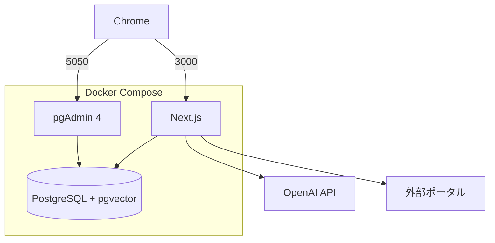
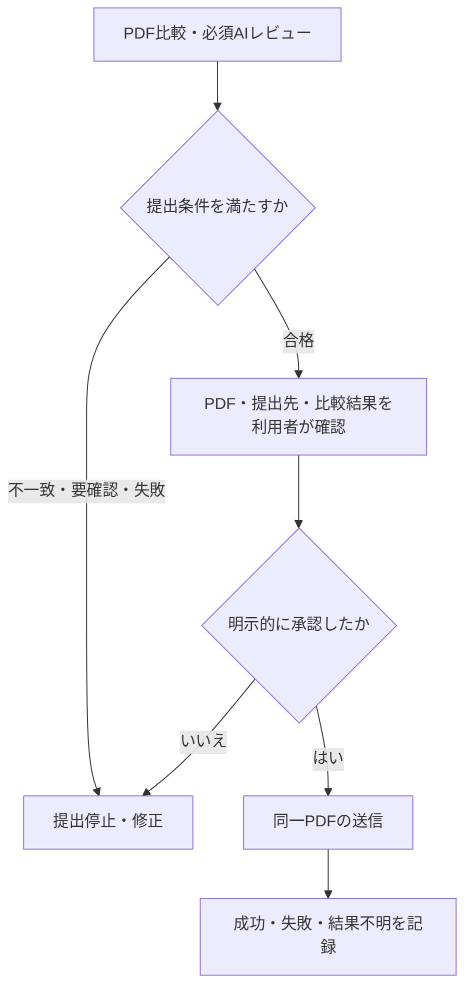
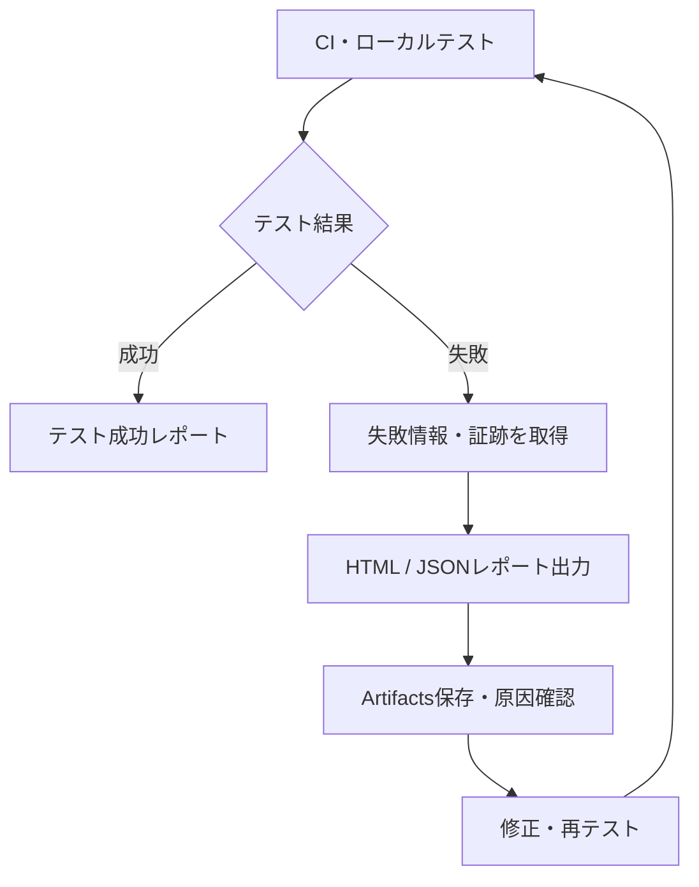

> **このファイルの用途：** Next.jsを中核にした月次作業報告書PDF比較アプリの目的、構成、Windows＋WSL2＋Docker Desktop環境構築、GitHub／SourceTree連携・ブランチ運用、テスト手順、制限事項および追加開発の設計方針を説明します。
>
> **対象：** 自己学習・ポートフォリオ用MVP。業務運用前には実際の帳票レイアウト・送信許可・セキュリティの追加検証が必要です。

# ReportDiff AI — 月次作業報告書 AI差分チェックシステム

**プロジェクト名：** `ReportDiff AI`（ディレクトリ名・npmパッケージ名：`report-diff-ai`）

「**正本PDFを基準**」に、比較対象PDFの稼働時間・作業日数・担当者・案件・本文を照合するWebアプリケーションです。数値や日付は**プログラムで厳密比較**し、作業内容の言い換えなどの意味的な違いは**RAGで根拠を検索した上でLLMが補足分析**します。

- **Next.js 16 App Router** をフロントエンド・バックエンド共通のフレームワークとして採用（React 19 / TypeScript）
- **Node.js 24** はNext.jsのサーバー実行環境として使用する。独立したバックエンドは構築しない
- **npm**で依存関係を管理（Yarnは使用しない）
- **LLM＋RAGは必須**。設定不足や通信エラー時に「比較完了」と表示しない
- **Windows版Docker Desktop＋WSL2＋Linuxコンテナを必須**の開発環境とし、**GitHub＋SourceTree**で履歴・ブランチを管理する
- **GitHubはPublicリポジトリ**として運用する。公開可能なソースコード・DDL・架空テストデータのみを管理し、実データ・認証情報・DBバックアップは分離する（第4-9節・第12-5節）。
- ソースコードの**先頭に日本語で用途を記述**し、主要な関数にもコメントを記述
- **追加採用方針：** Tailwind CSS、PostgreSQL＋pgvector、pgAdmin 4、Zod、OpenAI Codex、Vitest、Playwright、GitHub Actions。バックエンドの型安全性・セキュリティ強化、外部サイトへの提出支援、不具合レポート自動出力を計画する（詳細は第11章以降）。

> 本READMEの追加開発方針は、既存のMVPへの実装完了を意味しません。第1〜10章は既存の実装と開発手順（第5章は追加機能の導入計画）、第11〜16章は今後の実装計画、第17章は技術選定の意図です。

## 1. 実装済み機能と開発状況

| 項目                                                       | 実装             | 検証状況                                                            |
| ---------------------------------------------------------- | ---------------- | ------------------------------------------------------------------- |
| 正本・比較対象PDFのアップロード                            | 済               | HTTP経由の実行は未検証                                              |
| PDFテキスト抽出（unpdf、ページ番号保持）                   | 済               | 実PDF読込テストを追加・実行待ち                                     |
| 対象年月・作業者・案件・作業日数・稼働時間・残業時間の比較 | 済               | 単体テスト成功                                                      |
| 同月比較 / 異月比較                                        | 済               | 単体テスト成功                                                      |
| 本文の行差分・PDFプレビュー                                | 済               | ブラウザーE2Eは未検証                                               |
| Embedding＋コサイン類似度のRAG検索                         | 済               | 純粋関数テスト成功、実API未検証                                     |
| OpenAI Responses APIによるLLMレビュー                      | 済               | 応答検証テスト成功、実API未検証                                     |
| Docker開発環境（Dockerfile.dev / compose.yaml）            | 設定あり         | ユーザーのWSL2環境でNext.js開発サーバー起動ログを確認（2026-11-09） |
| PostgreSQL / pgvector / pgAdmin 4、OCR、日別明細、ログイン | 未実装           | —                                                                   |
| Tailwind CSSによるUI刷新                                   | 採用予定・未実装 | —                                                                   |
| 外部ポータルへのPDF提出連携                                | 計画・未実装     | API・画面仕様・利用許可の確認が必要                                 |
| CodexによるPRレビュー / GitHub ActionsによるCI             | 採用予定・未設定 | —                                                                   |
| Vitest / Playwright / 不具合レポート自動出力               | 採用予定・未実装 | —                                                                   |
| Zodによるバックエンド入出力検証・セキュリティ強化          | 採用予定         | 既存の依存関係と実装範囲を確認後に着手                              |

**現在はMVPの開発段階です。** 作成時の自動テスト19件は成功しました。その後、ユーザーのWindows 11＋WSL2環境でNext.js 16.4.5の開発サーバー起動ログを確認しています。ただし、**Next.jsの本番ビルド・OpenAI API実通信・型チェックの最終的な成功は未確認**です。2026-11-09には`lib/pdf.ts`の`PDFDocumentProxy.destroy()`に関する型エラーが報告されており、修正後の再確認が必要です。初期時点の検証結果は[`docs/TEST_REPORT.md`](docs/TEST_REPORT.md)に記載しています。

## 2. アーキテクチャ

```text
ブラウザー（Next.js Client Component）
    ├── 正本PDF（source）
    └── 比較対象PDF（target）
             │ FormData
             ▼
Next.js Route Handler: POST /api/compare (Node.js Runtime)
             ▼
    lib/pdf.ts: unpdfによるページ別テキスト抽出
             ▼
    lib/compare-flow.ts: オーケストレーション
          ├── lib/compare.ts: 数値・日付・本文のルール比較
          └── lib/rag.ts: チャンク分割・Embedding・関連文検索
                   ├── lib/rag-core.ts: 類似度とランキング（テスト可能）
                   └── lib/llm.ts: Responses API / Structured Outputs
                            ▼
                   lib/ai-guard.ts: 根拠ID・形式の検証
             ▼
 Reactへ比較結果JSONを返す（AIエラーならHTTP 502）
```

**RAGは何をしている？** 両PDFの抽出テキストをページごとに約700文字で分割し、Embedding APIへ送信してベクトル化します。比較結果に関する検索文と各チャンクの**コサイン類似度**を計算し、正本・対象からそれぞれ上位5件を選びます。LLMはそれらとルール比較結果をもとに日本語で説明します。

- 今回のRAGは**メモリ上の検索**です。PostgreSQL/pgvectorへの永続保存は未実装です。
- チャンクはPDF全体を作成します（従来の先頭50件制限を撤廃）。ただし**検索結果は各5件**のため、すべての差分の発見を保証するものではありません。
- 極端な長文（1文書400チャンク超）は黙って一部を省略せず、エラーにします。
- ファイルはサーバーに永続保存しません。Embedding/LLMへの送信内容・APIの保持規定は別途確認してください。

詳しい技術選定と流れは [`docs/ARCHITECTURE.md`](docs/ARCHITECTURE.md)、ファイルごとの役割は [`docs/FILE_PURPOSES.md`](docs/FILE_PURPOSES.md) を参照してください。**旧版の`README-docker-wsl2.md`とは併用せず、このREADMEの環境構築手順を正とします。**

## 3. Windows 11 + WSL2 + Docker Desktopの構築手順

### 3-1. 事前条件

- Windows 11、BIOS/UEFIで仮想化が有効なPC
- インターネット接続、管理者権限
- Docker Desktop（Windows版、必須）、Visual Studio Code + WSL拡張（推奨）
- OpenAI APIキー（**ChatGPT Plus等とは別契約・従量課金**）

### 3-2. WSL2 / Ubuntuのインストール【Windows PowerShell 管理者】

```powershell
# Ubuntuを導入（インストール済みなら不要）
wsl --install -d Ubuntu
# WSLを更新
wsl --update
# UbuntuがVERSION 2で動いているか確認
wsl --list --verbose
```

必要なら再起動し、Ubuntu初回起動でLinuxユーザーを設定します。`VERSION 1`なら `wsl --set-version Ubuntu 2` を実行します。

### 3-3. Docker Desktopの導入【Windows】

Windows版Docker Desktopを採用し、WSL2上のUbuntuからLinuxコンテナを操作する。WindowsのGUIによるコンテナ管理とLinuxベースの開発環境を両立するためである。採用理由の詳細は第17-2節を参照する。

1. [Docker Desktop公式サイト](https://www.docker.com/products/docker-desktop/)からインストールします。
2. Docker Desktopを起動し、`Settings > General > Use WSL 2 based engine`を有効にします（自動設定済みの場合は表示されないこともあります）。
3. `Settings > Resources > WSL Integration`で**Ubuntu**を有効にし、適用・再起動します。
4. **Linuxコンテナモード**であることを確認します。Ubuntu内にDocker Engineを二重インストールする必要はありません。

公式ガイド: [Docker Desktop on WSL2](https://docs.docker.com/desktop/features/wsl/)

### 3-4. Docker起動の確認【Windows PowerShell → Ubuntuターミナル】

```powershell
# Windows側
docker --version
docker compose version
docker run --rm hello-world
```

```bash
# Ubuntu側（WSL Integrationの確認）
docker version
docker compose version
```

`docker version`がClientとServerの両方を出力できればDockerに接続できています。

### 3-5. ソースコードの配置【Ubuntuターミナル】

ReportDiff AIのソースコードは、**Ubuntu内の** `/home/ists/projects/report-diff-ai` に配置します。Linux側のファイルシステムを使うと、Next.jsのファイル監視やコンテナとのファイル共有が安定しやすくなります。

GitHubにソースコードが登録済みで、Ubuntuに開発用ディレクトリがまだ存在しない場合は、Gitの導入・SSH認証（第4章参照）の後、次の手順でクローンします。

```bash
mkdir -p ~/projects
cd ~/projects
git clone git@github.com:adt718/report-diff-ai.git
```

すでに開発用ソースが存在する場合はクローンを行わず、既存のディレクトリを使用してください。以降は共通の手順です。

```bash
# プロジェクトルートを開く
cd ~/projects/report-diff-ai

# 必要な設定ファイルを確認
ls -l README.md package.json compose.yaml Dockerfile.dev

# VS Code（WSL拡張がある場合）で開く
code .
```

Windowsエクスプローラーから編集する場合は、`\\wsl$\Ubuntu\home\ists\projects\report-diff-ai`で開くこともできます。ただし、開発時はVS CodeのWSL拡張で開く方法を推奨します。

### 3-6. OpenAIの環境変数

```bash
cp .env.example .env.local
nano .env.local
```

`.env.local`の例：

```dotenv
OPENAI_API_KEY=実際のAPIキー
OPENAI_MODEL=gpt-4.1-mini
OPENAI_EMBEDDING_MODEL=text-embedding-3-small
```

`.env.local`はGit追跡対象外です。APIキーをチャット・README・Gitへ転載しないでください。利用可能なLLMモデルIDは契約とプロジェクト設定により異なるため、必要なら `OPENAI_MODEL` を変更してください。

### 3-6a. npmとNext.jsのインストールについて（重要）

**このプロジェクトは新規作成済みのNext.jsアプリです。** `package.json` の `dependencies` に `next`・`react`・`react-dom` が登録されています。そのため、**`npx create-next-app` や `npm install next` を別途実行する必要はありません**。

**Docker必須の開発環境：**

- `Dockerfile.dev` の `FROM node:24-bookworm-slim` が **Node.js 24とnpm** を含む環境を用意します。
- 同ファイルの `RUN npm install`（ロックファイルがあれば `npm ci`）が **Next.js・Reactなどを一括インストール**します。
- UbuntuやWindowsにNode.js・npmを別途インストールする必要はありません。

```bash
# 下記3-7の起動コマンドで、必要なパッケージもDockerイメージへインストールされる
docker compose up --build -d

# 起動後のバージョン確認（ホストではなくコンテナ内で実行）
docker compose exec app node --version
docker compose exec app npm --version
docker compose exec app npm ls next react react-dom
```

`docker compose` は `.env.local` を読み込むため、**先に3-6の手順でファイルを作成**してください。`npm ls`でNext.js等のバージョンが表示されれば、依存関係がインストールされています。

> **補足：** `npm install next react react-dom` は _依存関係がまだない別のプロジェクト_ にNext.jsを追加する場合のコマンドです。ReportDiff AIでは登録済みなので実行不要です。また、`npx create-next-app@latest` は**新規プロジェクトを作るコマンド**であり、既存の `report-diff-ai` フォルダーでは実行しません。

### 3-7. DockerでNext.jsを起動【Ubuntuターミナル】

```bash
# Compose構成の検証（ファイルが読めるか確認）
docker compose config --quiet

# 初回ビルド・起動
docker compose up --build -d

# Next.jsの起動ログ（Readyを確認）
docker compose logs -f app
```

Windowsのブラウザーで **http://localhost:3000** を開きます。ブラウザーから `sample/report_source.pdf`（160時間）と `sample/report_target.pdf`（152時間）を選択します。**実際の比較ボタンを押すとOpenAI APIに通信し、API料金が発生します**。

UbuntuからWindows版Chromeを直接開く場合は、起動ログで `Ready` を確認した後、別のUbuntuターミナルで実行します（ChromeがWindowsにインストール済みでWSLの相互運用が有効であること）。

```bash
cmd.exe /C start chrome http://localhost:3000
```

### 3-8. package-lock.jsonの作成と依存関係の固定（重要）

**`package-lock.json` がGitHubで管理されている場合は、そのファイルを使用してください。** まだ生成されていない場合のみ、初回起動後に次の操作でホストのプロジェクトにも生成します。

```bash
# コンテナでlockfileを生成してUbuntu側のソースディレクトリへ保存
docker compose exec app npm install --package-lock-only

# 完成したlockfileを使うnpm ciビルドへ切り替え
docker compose up -d --build

# package-lock.jsonができたことを確認
ls -lh package-lock.json
```

**`package-lock.json`はGitにコミット**し、以後は`npm ci`で依存バージョンを固定します。`package.json`を変更したら`npm install`でlockfileを更新します。

### 3-9. Dockerコンテナから各種テストを実行

```bash
# 比較ロジック・RAG純粋関数・AI応答検証・疑似結合テスト
docker compose exec app npm run test:core

# 実物のサンプルPDFをunpdfで解析（OpenAI APIには接続しない）
docker compose exec app npm run test:pdf

# TypeScript型チェック
docker compose exec app npm run typecheck
```

**実APIスモークテスト（有料）**：アプリが起動し、`.env.local`を設定した後に実行します。結果の概要・正本側根拠・比較側根拠、160時間と152時間の差分を確認します。

```bash
docker compose exec app npm run test:smoke
```

Next.jsの本番ビルドは、開発サーバーと`.next`ディレクトリの競合を避けるため別実行にします。

```bash
docker compose stop app
docker compose run --rm --no-deps app npm run build
docker compose up -d
```

### 3-10. 停止・再起動

```bash
docker compose down           # 停止。named volumeは残る
docker compose up -d          # 再起動
docker compose logs -f app    # ログ確認
# docker compose down -v はnode_modules等を消すので注意（DB導入後はDBデータも削除し得る）
```

## 4. Git / GitHub / SourceTreeの連携とブランチ運用

> **この章の用途：** Ubuntu（WSL2）の同一ソースコードをVS Code・Docker・Windows版SourceTreeで利用し、GitHubとの同期、コミット、`main` / `develop` の運用を行う。作業フォルダーは移動しない。

### 4-0. GitHub・SourceTreeの初期環境構築

GitHubはリモートリポジトリを管理するサービス、Gitはバージョン管理の実行ツール、SourceTreeはGitを画面上で操作するGUIクライアントである。GitHub・SourceTreeはアプリの実行用Dockerコンテナにインストールしない。

| 導入先         | 対象                     | 用途                                       |
| -------------- | ------------------------ | ------------------------------------------ |
| Windows        | Git for Windows          | SourceTreeから使用するGit・OpenSSH         |
| Windows        | SourceTree               | コミット、Push、Pull、ブランチ操作         |
| Ubuntu（WSL2） | Git・OpenSSHクライアント | UbuntuターミナルからのGit操作・SSH認証     |
| ブラウザー     | GitHubアカウント         | リポジトリ、Pull Request、ソースコード管理 |

#### 1. GitHubアカウントの準備【ブラウザー】

[GitHub](https://github.com/) にサインインする。アカウントがない場合のみ新規登録し、メールアドレス確認・必要な二要素認証を設定する。既存アカウントを利用する場合は新規作成不要。対象リポジトリが作成済みならそのまま使用する（第4-3節）。

#### 2. Git for Windowsの導入【Windows】

既に導入済みなら再インストールしない。未導入の場合は[Git公式サイト](https://git-scm.com/install/windows)からインストーラーを取得する。ダウンロードして実行するか、WindowsのPowerShellで以下のコマンドを実行する。

```powershell
winget install --id Git.Git -e --source winget
```

インストール後、新しいGit Bashを起動して確認する。

```bash
git --version
ssh -V
```

Gitのコミット作成者情報が未設定の場合は設定する（Windows側のGit Bash）。

```bash
git config --global user.name "YOUR_NAME"
git config --global user.email "YOUR_GITHUB_EMAIL"
```

#### 3. SourceTreeの導入【Windows】

1. [SourceTree公式サイト](https://www.sourcetreeapp.com/)からWindows版をダウンロードし、インストールする。
2. 初回起動時の案内に従い、セットアップを完了する。アカウント登録・認証の画面はバージョンによって異なる。
3. `ツール → オプション → Git`（Tools → Options → Git）で `System Git` を選び、導入済みのGit for Windowsを使用する。
4. `ツール → オプション → 全般`（General）のSSHクライアント設定で `OpenSSH` を選択する。本プロジェクトのSSH鍵はOpenSSH形式として管理し、PuTTY/Plinkと混在させない。
5. 必要に応じて `ツール → オプション → 認証` でGitHubアカウントを登録する。これはリポジトリ参照等のための設定であり、SSHによるPush・Pullの認証には別途公開鍵の登録が必要（第4-4節・第4-4a節）。

SourceTreeの設定手順：[System Gitの利用（Atlassian公式）](https://support.atlassian.com/sourcetree/kb/using-embedded-git-or-system-git-in-sourcetree/)。

### 4-1. 開発場所とGit操作の役割

| 環境                    | 使い方                                                                        |
| ----------------------- | ----------------------------------------------------------------------------- |
| Ubuntu（WSL2）          | `/home/ists/projects/report-diff-ai` に**唯一の開発用ソース**と `.git` を配置 |
| VS Code（WSL）          | 同じディレクトリでコード編集                                                  |
| Docker Desktop + Ubuntu | 同じディレクトリで `docker compose` を実行                                    |
| SourceTree（Windows）   | WSLの**既存リポジトリ**を開き、コミット・Push・Pull・ブランチ操作             |
| GitHub                  | `adt718/report-diff-ai` をリモートリポジトリ（`origin`）として使用            |

- 開発用ソースはUbuntu側のディレクトリに一元化し、複数の作業コピーを混在させないでください。
- **SourceTreeからWSLフォルダーを開くことはGitHubへの「リモート接続」ではありません。** GitHubへの通信が必要なのはPush・Pull・Fetchです。
- Windows版SourceTreeによるWSLのファイル操作は、環境によって遅延・権限・改行コードの問題が生じます。問題がある場合はUbuntuの `git` CLIを利用します。

### 4-2. Gitの導入と初期化【Ubuntu】

UbuntuにGitまたはOpenSSHクライアントが存在しない場合のみ導入する。Windows側のGit for Windowsとは別環境である。

```bash
sudo apt update
sudo apt install -y git openssh-client
```

```bash
cd /home/ists/projects/report-diff-ai

# Gitの確認。なければ sudo apt update && sudo apt install -y git
git --version

# 既存のGit管理状態を確認
git status
```

`fatal: not a git repository` の場合だけ、**このディレクトリで**次を実行します。

```bash
git init -b main
```

Gitのコミット作成者情報が未設定なら、Ubuntuで設定します（実際の名前・GitHubで利用するメールアドレスに変更）。

```bash
git config --global user.name "YOUR_NAME"
git config --global user.email "YOUR_GITHUB_EMAIL"
```

SourceTree（Windows版Git）でコミットする場合は、Windows側のGitにもコミット作成者情報を設定してください。GitHubのログイン認証とコミット作成者情報は別物です。

### 4-3. GitHubに新規リポジトリを作る【ブラウザー】

[GitHubの新規リポジトリ作成画面](https://github.com/new) を開き、Repository nameを **`report-diff-ai`**、Visibilityを **Public** にします。ポートフォリオとして公開可能なファイルのみを登録します。ローカルにREADMEや`.gitignore`があるため、GitHub側のREADME、`.gitignore`、Licenseの自動追加は選択しません。既に作成済みのPublicリポジトリはそのまま使用します。

Publicリポジトリの公開は、アプリやDBをインターネットに公開することとは異なります。現段階ではアプリとDBをローカル開発環境内で運用します。公開対象・機密情報の管理は第4-9節に従います。

GitHub上でリポジトリを作成しただけでは、Ubuntuのファイルは自動アップロードされません。

### 4-4. SSH認証とリモート設定【Ubuntu】

Ubuntuで作成済みの公開鍵がGitHubに登録されているか確認します。秘密鍵（`~/.ssh/id_ed25519`）は共有・Git登録しません。

鍵が未作成の場合は、既存の鍵を上書きしないことを確認した上でUbuntuで作成する。`-C` は大文字で指定する。

```bash
ssh-keygen -t ed25519 -C "YOUR_GITHUB_EMAIL"
```

保存先は通常 `~/.ssh/id_ed25519` とする。パスフレーズを設定する。既に同名の鍵が存在する場合は上書きを選択しない。GitHubの `Settings → SSH and GPG keys → New SSH key` を開き、公開鍵（`.pub`）の内容を登録する。

```bash
cat ~/.ssh/id_ed25519.pub
```

`ssh-ed25519` から始まる公開鍵の1行全体をコピーする。秘密鍵はコピーしない。

```bash
# 公開鍵の所在を確認
ls -l ~/.ssh/id_ed25519.pub

# GitHubへのSSH認証確認
ssh -T git@github.com
```

`Hi adt718! You've successfully authenticated...` と表示されたら、Ubuntu側の認証成功です。初回接続時はホスト鍵のフィンガープリントを[GitHub公式情報](https://docs.github.com/en/authentication/connecting-to-github-with-ssh/testing-your-ssh-connection)と照合してから許可します。

```bash
cd /home/ists/projects/report-diff-ai
# 登録済みのリモートを確認
git remote -v

# originが存在しないときだけ実行
git remote add origin git@github.com:adt718/report-diff-ai.git

# originが存在していてURLを直す場合は「add」ではなく次を利用
# git remote set-url origin git@github.com:adt718/report-diff-ai.git
```

**重要：** Ubuntuで成功したSSH認証は、Windows版SourceTreeには自動共有されません。SourceTreeでPush・Pullする場合は、Windows側にも認証設定が必要です。SSH方式を維持するならWindows用のSSH鍵を別途作成し、GitHubに**公開鍵だけ**を登録して、SourceTreeのSSHクライアント設定を確認します。HTTPS/OAuth方式へ変更することも可能ですが、同じ`.git/config`を利用しているため`origin`のURL変更はUbuntu側にも反映されます。

### 4-4a. Windows版SourceTreeのSSH認証設定【Windows】

WSLとWindowsのホームディレクトリは別である。WSLの鍵をWindowsへコピーせず、Windows側の鍵をGitHubに登録する。両方のSSH公開鍵を同一GitHubアカウントに登録できる。

#### 1. Windows側のSSH鍵を確認する

WindowsのPowerShellで実行する。

```powershell
Get-ChildItem "$env:USERPROFILE\.ssh" -ErrorAction SilentlyContinue
```

`id_ed25519`（秘密鍵）と `id_ed25519.pub`（公開鍵）があり、GitHubへの認証に使用する鍵なら再利用する。鍵がない場合のみ、Windows側で新規作成する。

```powershell
ssh-keygen -t ed25519 -C "YOUR_GITHUB_EMAIL"
```

既存鍵を上書きしない。パスフレーズを設定する。別の用途で使用中の鍵しかない場合は、その鍵を上書きせず、専用の鍵名とSSH設定を用意してから認証する。

#### 2. Windows側の公開鍵をGitHubに登録する

```powershell
Get-Content "$env:USERPROFILE\.ssh\id_ed25519.pub" | Set-Clipboard
```

GitHubの [SSH and GPG keys](https://github.com/settings/keys) → `New SSH key` を開き、Titleに `Windows-SourceTree` 等の識別しやすい名前、Key typeに `Authentication Key`、Keyにコピーした`.pub`の内容を貼り付ける（同じ鍵が既に登録済みなら追加不要）。秘密鍵は登録しない。

#### 3. Windows側の接続を確認する

```powershell
ssh -i "$env:USERPROFILE\.ssh\id_ed25519" -o IdentitiesOnly=yes -T git@github.com
```

初回のホスト鍵確認では[GitHub公式フィンガープリント](https://docs.github.com/en/authentication/keeping-your-account-and-data-secure/githubs-ssh-key-fingerprints)と照合する。`Hi adt718! You've successfully authenticated, but GitHub does not provide shell access.` が表示されれば認証成功。GitHubはシェル接続を提供しないため、終了コードが1でもこのメッセージが成功の判定となる。

SourceTreeは第4-0節に従いSystem GitとOpenSSHを選択する。Windows PowerShellのOpenSSHとGit for WindowsのOpenSSHが異なる場合があるため、SourceTreeで使用するGitのターミナルでも `ssh -T git@github.com` を確認する。パスフレーズ付き鍵をエージェントで管理する場合は[GitHub公式のSSH鍵・エージェント設定](https://docs.github.com/ja/authentication/connecting-to-github-with-ssh/generating-a-new-ssh-key-and-adding-it-to-the-ssh-agent?platform=windows)に沿う。

#### 4. SourceTreeからの接続を確認する

対象リポジトリを第4-5節の手順で追加し、SourceTreeのフェッチを実行する。リモートURLは `git@github.com:adt718/report-diff-ai.git`、リモート名は `origin` とする。フェッチが成功すれば認証とリモート接続が確認できる。

Git Bashで確認する場合（リポジトリを開いた状態）：

```bash
git remote -v
git ls-remote origin
```

SSH認証成功とリポジトリへのアクセス許可は別のため、`ssh -T` に成功しても `git ls-remote origin` が失敗する場合は、リモートURL・GitHubアカウントの対象リポジトリへの権限を確認する。

### 4-5. SourceTreeにUbuntu上のリポジトリを登録【Windows】

1. WindowsでSourceTreeを起動します。
2. **「クローン」ではなく、「Add / Add Existing Local Repository（既存の作業コピーを追加）」**を選びます。
3. 次の**WindowsのUNCパス**を指定します。

```text
\\wsl.localhost\Ubuntu\home\ists\projects\report-diff-ai
```

Git BashにこのUNCパスだけを貼り付けて実行してはいけません。Git Bashからアクセスするなら `cd '//wsl.localhost/Ubuntu/home/ists/projects/report-diff-ai'` のように引用符付きのパスを使います。

`fatal: detected dubious ownership` が表示された場合、**WindowsのGit Bash**でSourceTreeのエラーに表示された当該リポジトリだけを `safe.directory` に登録し、再度開きます。現在の環境で表示されたパスの例：

```bash
# Windows側Git Bashで実行（Ubuntu側ではない）
git config --global --add safe.directory '%(prefix)///wsl.localhost/Ubuntu/home/ists/projects/report-diff-ai'
git config --global --get-all safe.directory

# Windows版Gitで実際に操作できるか確認
git -C '//wsl.localhost/Ubuntu/home/ists/projects/report-diff-ai' status
```

パスはSourceTreeが表示したものを優先してください。**`safe.directory '*'` で全リポジトリを許可しないでください。** 設定はGitの所有者チェックに対する例外であり、GitHub認証そのものではありません。SourceTreeが別のGit実行ファイルを使う場合は、適用先のGit設定も確認してください。

### 4-6. 初回コミットとPush【SourceTree】

1. `.gitignore`で `.env`・`.env.local`・実データ・バックアップ・テスト成果物・`node_modules/`・`.next/` 等が除外されていることを確認します（第4-9節）。**`package-lock.json`はGit管理します。**
2. Ubuntuで `git check-ignore -v .env .env.local` を実行して除外を確認します。既にGitの管理下にある秘密情報は、`.gitignore`だけでは除外できません。
3. SourceTreeの **File Status（ファイルステータス）** で登録予定の変更を確認し、必要なファイルをStageします。
4. APIキー、実際の業務PDF・個人情報、DBバックアップなどが含まれていないことを確認して `Initial commit: ReportDiff AI` などのコメントでCommitします。
5. SourceTreeのリモート設定で `origin` を確認し、**Windows側のGitHub認証ができている状態で**Pushします。初回はローカルの `main` と `origin/main` を追跡設定します。

Ubuntuでも同じGit履歴を確認できます。

```bash
cd /home/ists/projects/report-diff-ai
git status
git log --oneline -5
git branch -vv
git remote -v
```

### 4-7. ブランチ構成と運用【SourceTree】

#### ブランチの用途

| ブランチ    | 用途                               | 作成元    | マージ先  |
| ----------- | ---------------------------------- | --------- | --------- |
| `main`      | 初期ソース・動作確認済みの安定版   | —         | —         |
| `develop`   | 開発中の機能を統合し、動作確認する | `main`    | `main`    |
| `feature/*` | 機能追加・ライブラリ導入           | `develop` | `develop` |
| `fix/*`     | 不具合修正                         | `develop` | `develop` |
| `docs/*`    | README・設計資料の更新             | `develop` | `develop` |

#### 機能別ブランチ

以下のブランチを機能単位で使用する。

| ブランチ名                             | 用途                                                                                                                                                                                                                                            |
| -------------------------------------- | ----------------------------------------------------------------------------------------------------------------------------------------------------------------------------------------------------------------------------------------------- |
| `docs/update-readme`                   | READMEの更新（技術選定・構成・開発計画）                                                                                                                                                                                                        |
| `feature/tailwind-css`                 | Tailwind CSS導入・画面レイアウトの整備                                                                                                                                                                                                          |
| `feature/postgresql`                   | PostgreSQLコンテナ・DB接続・永続化・スキーマ管理・pgAdmin 4によるGUI管理                                                                                                                                                                        |
| `feature/pgvector`                     | Embeddingの保存・ベクトル検索・RAGの拡張                                                                                                                                                                                                        |
| `feature/codex-review`                 | CodexによるPRレビューの導入・レビュー方針の整備                                                                                                                                                                                                 |
| `feature/github-actions`               | GitHub ActionsによるCI・品質チェックの自動化                                                                                                                                                                                                    |
| `feature/vitest`                       | Vitestによる単体・結合テスト・カバレッジ                                                                                                                                                                                                        |
| `feature/playwright`                   | PlaywrightによるE2Eテスト・失敗時の証跡取得                                                                                                                                                                                                     |
| `feature/defect-report`                | 不具合レポート出力。Vitest・Playwrightのテスト失敗時に、期待値・実際値、エラー内容、発生箇所、スクリーンショット（E2E）等の調査情報を自動収集し、HTML・JSON形式で出力・保存する。原因調査・修正・再テストの効率化を目的とする（第15-2節参照）。 |
| `feature/portal-upload`                | 比較・承認済みPDFの外部ポータルへの提出支援                                                                                                                                                                                                     |
| `feature/zod-validation`（追加予定）   | ZodによるAPI入出力・外部サービス応答の実行時検証と型安全性の強化                                                                                                                                                                                |
| `feature/backend-security`（追加予定） | PDF受信時の検証、DBアクセス・機密情報保護、例外処理、外部提出時のセキュリティ強化                                                                                                                                                               |

日別明細の比較など、追加の機能は必要に応じて `feature/daily-work-records` などのブランチを作成する。不具合修正は `fix/pdf-type-error` など、修正対象が分かる名前とする。

#### 開発フロー

**初回の `develop` 作成：** SourceTreeで`main`をチェックアウト → `Branch` → 名前を`develop` → 作成と同時にCheckout → `develop`をPush（追跡設定）。Ubuntuで `git branch --show-current` が `develop` になるか確認します。

#### 普段の開発

1. SourceTreeで `develop` をチェックアウトし、Pullして最新化します。
2. `develop` から対象の作業ブランチを作成してチェックアウトします。作成済みの作業ブランチを使う場合は、未コミットの変更を確認し、必要に応じて最新の `develop` を取り込みます。
3. VS Code（WSL）で編集し、Ubuntuから `docker compose up -d`、`docker compose exec app npm run typecheck`、`docker compose exec app npm run test:core` などで検証します。
4. SourceTreeで差分と機密情報の混入がないことを確認してCommitします。対象の作業ブランチのみをPushします。
5. GitHubで対象ブランチから `develop` へのPull Requestを作成します。レビュー・テスト結果を確認してマージします。
6. `develop` で機能統合後の動作確認を行い、安定版にする際は `develop` から `main` へのPull Requestを作成します。

#### リモートブランチの作成と追跡設定

ローカルで作成したブランチはPushするまでGitHubに反映されません。`origin` が設定済みで、Windows側のSSH認証も成功している場合は、ブランチごとにリモートURLやSSHキーを設定し直す必要はありません。

まず `develop` をPushして、Pull Requestのマージ先となる `origin/develop` を作成します。作業ブランチの初回Pushは、SourceTreeの「プッシュ」で次のように設定します（README更新の例）。

| 設定項目                       | 設定値               |
| ------------------------------ | -------------------- |
| プッシュ先                     | `origin`             |
| ローカルブランチ               | `docs/update-readme` |
| リモートブランチ               | `docs/update-readme` |
| 追跡中                         | チェックを入れる     |
| その他のブランチ・強制プッシュ | チェックを外す       |

`origin/docs/update-readme` が作成されたら、GitHub上で `base: develop`、`compare: docs/update-readme` を指定してPull Requestを作成します。未着手の機能ブランチは必要になった時点でPushします。追跡先を `origin/main` に設定しないよう注意してください。

コミットメッセージは変更内容に応じて `docs: READMEを更新`、`feat: Tailwind CSSを導入`、`fix: PDF解析時の型エラーを修正` などとします。

**注意：** 同じ作業ツリーのブランチをSourceTreeで切り替えると、Ubuntuのファイルも同時に切り替わります。未コミットの変更は先にCommitまたはStashしてください。依存関係の変更を伴う切り替えでは、開発サーバーを止めて `docker compose up --build -d` で再構築することがあります。

### 4-8. よくあるGitトラブル

| 症状                                                                     | 確認すること                                                                          |
| ------------------------------------------------------------------------ | ------------------------------------------------------------------------------------- |
| `fatal: not a git repository`                                            | Ubuntuのプロジェクト直下か確認し、未初期化なら`git init -b main`                      |
| SourceTreeでUNCパスが「クローン元として不正」                            | `Clone`ではなく`Add Existing Local Repository`を選ぶ                                  |
| `fatal: detected dubious ownership`                                      | Windows版Gitに**当該パスのみ**`safe.directory`を登録                                  |
| WSLでは`ssh -T`成功、SourceTreeのPush失敗                                | **Windows側**の公開鍵登録・OpenSSH設定・System Git・リモートURLを第4-4a節に従って確認 |
| `No supported authentication methods available (server sent: publickey)` | SourceTreeのPuTTY/PlinkとOpenSSHの設定が混在していないか確認する                      |
| `Permission denied (publickey)`                                          | Windows側とWSL側の鍵を区別し、接続元の公開鍵がGitHubに登録されているか確認する        |
| `remote origin already exists`                                           | `git remote -v`で確認。既存URLを変更するなら`git remote set-url origin ...`           |
| ブランチ切替が失敗                                                       | 未コミットの変更や未追跡ファイルの衝突を確認してCommit/Stash                          |
| SourceTreeが遅い・ファイル差分が大量                                     | WSLのUNC経由アクセス、改行コード、`node_modules`や生成ファイルのGit除外を確認         |
| GitHubへ秘密情報をPushした                                               | ファイル削除だけで安心せず、**APIキーを失効・再発行**し履歴の扱いを検討               |

参考： [Gitの`safe.directory`公式説明](https://git-scm.com/docs/git-config#Documentation/git-config.txt-safedirectory) / [GitHub SSH認証](https://docs.github.com/en/authentication/connecting-to-github-with-ssh/about-ssh)

### 4-9. Publicリポジトリのデータ管理・セキュリティ方針

GitHubで公開する開発資産と、非公開で管理するデータを分離する。すべてのブランチ・コミット履歴・PR・CIログ等が公開され得ることを前提に運用する。

| 管理対象                                        | 管理場所・公開方針                                                                                 |
| ----------------------------------------------- | -------------------------------------------------------------------------------------------------- |
| ソースコード、README、設計資料、Docker設定      | 公開可能な内容のみGitHub（Public）で管理する。                                                     |
| DDL・マイグレーションSQL                        | 本プロジェクトの公開可能なDB構造のみGitHubで履歴管理する。実業務の機密スキーマ・設定は公開しない。 |
| テストデータ・サンプルPDF                       | 個人情報や実業務情報を含まない架空データのみGitHubで管理する。                                     |
| 実際の業務データ、抽出本文・Embedding・比較結果 | 業務利用が承認された環境のPostgreSQL等でアクセス制限して管理する。現段階のMVPでは使用しない。      |
| 実際の業務PDF                                   | Git管理対象外。必要な保管は許可されたアクセス制限付きストレージで行う。                            |
| DBバックアップ                                  | Gitリポジトリ・DBの永続ボリュームとは別の暗号化されたストレージに保管する。                        |
| OpenAI APIキー、DB・pgAdmin認証情報             | ローカルではGit管理対象外の `.env` / `.env.local`、本番では承認されたシークレット管理を使用する。  |
| CI/CD用の認証情報                               | 必要な場合に限りGitHub Actions Secretsを使用し、最小権限を付与する。                               |

#### `.gitignore` の追加設定例

既存の除外設定を維持し、必要な項目を追記する。DDL・架空データのSQL・`.env.example`・`package-lock.json` はGit管理対象とする。

```gitignore
# 環境変数・認証情報
.env
.env.*
!.env.example
*.pem
*.key

# DBバックアップ・実データ
backups/
*.dump
*.backup
data/private/
uploads/

# テスト実行結果
test-results/
playwright-report/
coverage/
reports/vitest/
reports/defects/
```

上記は除外パターンの例である。バックアップSQL・CSV・PDF等は拡張子だけで区別せず、Git管理外の保管先を使用する。既存の `.env.example` にはダミー値のみを記載する。

#### Push前の確認と漏えい時の対応

- GitHubアカウントの二要素認証を設定し、Secret Scanning・Push Protectionの設定を確認する。自動検出だけに依存しない。
- SourceTreeの差分、Gitの追跡対象、PR・ログ・画像・テストレポートを確認する。秘密情報や個人情報を含む変更はCommit・Pushしない。
- `.gitignore` は既に追跡・公開されたファイルや過去のコミットを削除しない。既に公開した認証情報は直ちに失効・再発行し、必要に応じてGit履歴や公開成果物から除去する。第三者による取得済みコピーを取り消せるとは限らない。
- CodexのレビューやGitHub Actionsへ実データ・秘密情報を入力しない。CIは架空データとモックを使用する。

公式資料：[GitHub Secret Scanning](https://docs.github.com/en/code-security/concepts/secret-security/secret-scanning)、[機密データの削除](https://docs.github.com/en/authentication/keeping-your-account-and-data-secure/removing-sensitive-data-from-a-repository)、[GitHub Actions Secrets](https://docs.github.com/en/actions/how-tos/write-workflows/choose-what-workflows-do/use-secrets)。

## 5. ブランチ別のインストール・セットアップ手順（実装予定）

既存の機能別ブランチを利用し、必要なパッケージのみを対象ブランチで導入する。以下は各機能を実装する際の手順であり、全コマンドを一括実行するものではない。ローカルでのnpm操作は必ずDockerコンテナ内で行う。

### 5-1. 共通手順

SourceTreeで対象ブランチをチェックアウトする。作業前に `develop` の最新変更を取り込み、未コミットの変更がないか確認する。Ubuntuターミナルで以下を実行する。

```bash
cd ~/projects/report-diff-ai
git branch --show-current
docker compose up -d --build
docker compose ps
```

依存関係を追加したら `package.json` と `package-lock.json` を同じブランチでコミットする。ブランチ切り替え後は、既存のnode_modulesボリュームとlockfileの不一致を防ぐため、lockfileがあることを確認して次を実行する。

```bash
docker compose stop app
docker compose run --rm --no-deps app npm ci
docker compose up -d app
```

以降の `docker compose exec app` はappが起動している状態で実行する。未起動時はビルド後に `docker compose run --rm --no-deps app npm ...` で一時コンテナを使用できる。

### 5-2. Tailwind CSS — `feature/tailwind-css`

```bash
docker compose exec app npm install -D tailwindcss @tailwindcss/postcss postcss
docker compose exec app npm ls tailwindcss @tailwindcss/postcss postcss
```

PostCSS設定とグローバルCSSを整備し、既存画面を段階的に変更する（第11-2節）。

### 5-3. PostgreSQL・pgAdmin 4 — `feature/postgresql`

第12-4節のDB・GUI設定を既存の `compose.yaml` に追加し、環境変数を設定してから実行する。

```bash
docker compose pull db pgadmin
docker compose up -d --wait db pgadmin
docker compose exec db psql -U reportdiff -d reportdiff -c "SELECT version();"
docker compose exec app npm install pg
docker compose exec app npm install -D @types/pg
```

`pg` はNode.jsからPostgreSQLへ接続するドライバー。pgAdmin 4は別コンテナとして起動するため、npmでのインストールは不要。DBへの接続処理・テーブル作成・マイグレーションと接続テストを実装する。DDL・テストデータの登録・更新・削除は第12-6節を参照する。

### 5-4. pgvector — `feature/pgvector`

`feature/postgresql` のマージ後、DBのバックアップを取得し、DBイメージを同じPostgreSQLメジャーバージョンの `pgvector/pgvector:pg17` に変更する。既存ボリュームは維持する。

```bash
docker compose pull db
docker compose up -d --wait db
docker compose exec db psql -U reportdiff -d reportdiff -c "CREATE EXTENSION IF NOT EXISTS vector;"
docker compose exec db psql -U reportdiff -d reportdiff -c "SELECT extversion FROM pg_extension WHERE extname = 'vector';"
```

pgvectorはPostgreSQLの拡張機能であり、npmインストールは不要。拡張機能の有効化はマイグレーションにも反映する。

### 5-5. Vitest — `feature/vitest`

```bash
docker compose exec app npm install -D vitest @vitest/coverage-v8
docker compose exec app npm install -D @testing-library/react @testing-library/jest-dom jsdom
```

Vitestの設定とテストコードを作成した後に実行する。

```bash
docker compose exec app npx vitest run
docker compose exec app npx vitest run --coverage
```

### 5-6. Playwright — `feature/playwright`

```bash
docker compose exec app npm install -D @playwright/test
```

ブラウザー本体・Linux依存関係を `Dockerfile.dev` のnpmインストール後に追加する（ビルド時にroot権限で実行し、実行ユーザーから読み取れる配置にする）。

```dockerfile
ENV PLAYWRIGHT_BROWSERS_PATH=/ms-playwright
RUN npx playwright install --with-deps chromium && chmod -R a+rX /ms-playwright
```

Playwrightの設定とテストコードを作成してから再ビルド・実行する。

```bash
docker compose up -d --build
docker compose exec app npx playwright --version
docker compose exec app npx playwright test
```

### 5-7. 不具合レポート出力 — `feature/defect-report`

VitestとPlaywrightのreporterを利用するため、基本的に追加ライブラリは不要。両ブランチのマージ後、HTML・JSONレポート出力設定を実装する（第15-2節）。

```bash
docker compose exec app npx vitest run
docker compose exec app npx playwright test
```

設定後はテスト失敗時の `reports/vitest/`、`playwright-report/`、`test-results/` を確認する。これらの生成物はGitの追跡対象外とする。

### 5-8. GitHub Actions — `feature/github-actions`

GitHub Actions自体はGitHubのサービスのため、インストール不要。必要な静的解析・整形ツールが未導入の場合のみ追加する。

```bash
docker compose exec app npm install -D eslint eslint-config-next prettier
```

設定ファイルとnpm scriptsを作成後、CIと同じ検査をローカルで実行する。

```bash
docker compose exec app npm run lint
docker compose exec app npm run format:check
docker compose exec app npm run typecheck
docker compose exec app npm run test
docker compose exec app npm run build
docker compose exec app npm run test:e2e
```

`.github/workflows/ci.yml` を作成し、PR作成・更新を契機に検証とレポート保存を自動化する。Vitest・Playwrightの導入後に統合する。

### 5-9. OpenAI Codex — `feature/codex-review`

GitHubのPRレビュー連携を使用するため、アプリへのnpmパッケージ追加は不要。CodexのGitHub連携・対象リポジトリのコードレビュー設定を行い、`AGENTS.md` にレビュー方針を記述する。PR上で `@codex review` をコメントして動作確認する（第14-1節）。

### 5-10. 外部ポータル連携 — `feature/portal-upload`

外部サイトが公式APIを提供する場合はNode.js標準の `fetch` を使用するため、原則追加ライブラリは不要。ブラウザー自動操作の許可が得られた場合のみ、アプリ実行用のPlaywrightを導入する。

```bash
docker compose exec app npm install playwright
docker compose exec app npm ls playwright @playwright/test
```

テスト用Playwrightとのバージョンを整合させ、ブラウザー環境は第5-6節のDocker構成で用意する。まずは模擬サイトで検証し、実サイトへの送信は利用許可・仕様確認後に実施する。

### 5-11. Zod — `feature/zod-validation`

TypeScriptの型検査だけでは、受信したリクエストや外部APIの応答の型・値を実行時に保証できない。Zodで実行時のデータ検証とTypeScriptの型定義を連携させる。

既存の `package.json` と `package-lock.json` を確認する。対象ブランチで直接依存関係の有無を確認する。

```bash
docker compose exec app npm ls zod --depth=0
```

Zodが未導入の場合に限り、次を実行する。

```bash
docker compose exec app npm install zod
```

すでに直接依存関係として登録済みの場合は再インストールせず、そのバージョンで実装する。追加した場合は `package.json` と `package-lock.json` をコミットする。

- リクエスト、PDFから抽出した構造化データ、OpenAI APIの応答、APIレスポンスのスキーマを定義する。
- `safeParse` で実行時に検証し、必須入力のnull・未定義・空・形式不正の場合は適切なエラーとして処理する。
- スキーマから `z.infer` でTypeScript型を導出し、重複した型定義を減らす。数値の範囲、年月、必須項目、根拠IDなど業務上の整合性も別途検証する。
- 既存のAI応答検証を維持し、移行時に検証を緩めない。PDF本体のヘッダー、サイズ、解析可否等はZodとは別に検証する。

```bash
docker compose exec app npm run typecheck
docker compose exec app npm run test
```

`npm run test` はVitest導入およびスクリプト追加後に実行する。それ以前は第3-9節の既存テストを実行する。

### 5-12. バックエンドセキュリティ — `feature/backend-security`

Next.jsのRoute Handlersを中心に、Zodの検証、PDFの安全な受信、パラメータ化SQL、例外処理、機密情報保護を実装する。追加のフレームワークやセキュリティライブラリは現段階で採用確定としない（詳細は第11-3節）。

```bash
docker compose exec app npm run typecheck
docker compose exec app npm run test
docker compose exec app npm run test:e2e
```

テスト用スクリプトはVitest・Playwrightの導入後に使用する。実際の利用者情報、APIキー、業務PDFをテストデータやログに含めない。

### 5-13. その他のブランチ

| ブランチ                               | インストール・作業                                                         |
| -------------------------------------- | -------------------------------------------------------------------------- |
| `main` / `develop`                     | 機能の統合・確認。lockfileを基準に第5-1節で依存関係を再現する。            |
| `docs/update-readme`                   | README・設計資料のみの更新。追加インストール不要。                         |
| `fix/*`                                | 原則として追加インストール不要。修正後に型チェック・関連テストを実施する。 |
| `feature/daily-work-records`（必要時） | 日別明細の比較拡張。原則として既存のPDF解析・比較・DB機能を利用する。      |

## 6. 不一致の表示仕様

**正本（source）を常に基準**にします。例：正本160時間、比較対象152時間は「重要な不一致」です。画面では正本値・比較値・判定・該当ページを示し、ページリンクからPDFを開けます。AIレビューには概要・追加の懸念・RAG根拠IDを表示します。

- 同月の数値差異：重要な不一致
- 作業内容の変更や欠落候補：要確認
- 異月の変更：原則参考情報（ミスとは自動判定しない）
- PDFの文字そのものを色枠でハイライトする機能：未実装

## 7. 制限事項とセキュリティ

- **テキストPDFのみ**。画像スキャン・OCR・複雑な表組み・日別の明細検証は未対応。
- 項目抽出は見出しが行頭にある形式を想定。実際の帳票に合わせて`lib/compare.ts`の見出し別名を調整してください。
- 1ファイル10MB / 30ページ / 抽出文字数上限200,000文字。本文差分表示は最大80行。
- AIは誤る可能性があり、RAGも各PDF上位5件しかLLMに渡しません。**「不一致なし」でもPDF全体が完全一致した保証にはなりません**。
- 認証、権限管理、レート制限、監査ログ、ウイルス検査、暗号化永続保存は未実装です。GitHubでソースコードを公開しても、アプリのインターネット公開や実務データでの運用は行わないでください。
- APIへPDF由来のテキストが送られます。現段階では架空データを使用します。将来の業務利用では、個人情報・機密情報を含む本文やEmbeddingの管理、外部送信の許可・送信範囲を事前に確認します。
- Docker Composeのポートは`127.0.0.1:3000:3000`に限定してあります（ローカル開発用）。

## 8. よくあるトラブル

| 症状                                 | 確認すること                                                     |
| ------------------------------------ | ---------------------------------------------------------------- |
| `docker: command not found` (Ubuntu) | Docker DesktopのWSL IntegrationでUbuntuを有効化                  |
| Docker daemonに接続できない          | Docker Desktop起動、WSL2、Linuxコンテナモードを確認              |
| `.env.local`がない                   | `cp .env.example .env.local`                                     |
| 比較時に503                          | `OPENAI_API_KEY`の未設定                                         |
| 比較時に502                          | OpenAI APIキー・利用権限・課金状態・モデルID・ネットワークを確認 |
| 3000番ポートが使用中                 | 既存サーバーを停止するかComposeのホストポートを変更              |
| PDFから文字が抽出できない            | スキャンPDFかどうか確認（OCRは未実装）                           |
| `npm ci`がlockfile不足で失敗         | 3-8に従い`npm install --package-lock-only`で生成                 |

## 9. ポートフォリオとして説明できるポイント

**Next.js App Routerの責務分離**（画面とRoute Handlers）、**型定義と数値の決定論的比較**、**RAGの検索設計**（チャンク・Embedding・コサイン類似度・出典追跡）、**LLM出力の検証**、**AIモックによる自動テスト**、**WSL2＋Dockerによる環境再現**を説明できるようにしています。

設計意図や検証の根拠は`docs/`に整理しました。実績として記載するのは、**実際に起動・確認した範囲だけ**にしてください。

## 10. 公式ドキュメント

- [Next.js App Router](https://nextjs.org/docs/app)
- [Docker Desktop WSL2](https://docs.docker.com/desktop/features/wsl/)
- [OpenAI Structured Outputs](https://developers.openai.com/api/docs/guides/structured-outputs)
- [OpenAI Embeddings](https://platform.openai.com/docs/guides/embeddings)

## 11. 追加開発の採用技術・構成（未実装）

> **この章の用途：** 今後導入する技術とその選定理由を整理する。実装・テストの完了後に第1章の開発状況を更新する。

技術の新しさだけを基準にせず、PDFの照合精度、保守性、個人開発での運用負荷、追加費用、実務への応用可能性を評価する。技術選定の意図は[第17章](#17-技術選定の意図)を参照する。

| 分類                 | 技術                                        | 採用理由・役割                                                                      |
| -------------------- | ------------------------------------------- | ----------------------------------------------------------------------------------- |
| フロントエンド       | Next.js App Router / React                  | 画面・コンポーネントの構築                                                          |
| 開発言語             | TypeScript                                  | フロントエンド・バックエンドの型安全性を確保                                        |
| 実行時バリデーション | **Zod**                                     | 外部入力・API応答をスキーマで検証し、TypeScriptの型に連携                           |
| CSS                  | **Tailwind CSS**                            | ユーティリティクラスで一貫した画面を構築し、既存のReact経験にスタイリング技術を追加 |
| バックエンド         | Next.js Route Handlers                      | PDF解析、比較、RAG、DB操作、提出制御。Express等の別フレームワークは採用しない       |
| 実行環境             | Node.js 24                                  | Next.jsのサーバー側処理を実行するランタイム                                         |
| DB                   | **PostgreSQL**                              | 報告書属性、差分、比較履歴、提出状態の永続管理                                      |
| ベクトル検索         | **pgvector**                                | Embeddingの永続化・類似検索。業務データとRAGを同じDBで扱う                          |
| DB管理GUI            | **pgAdmin 4**                               | Chromeでテーブル、データ、スキーマおよびSQL実行結果を確認する                       |
| DB接続ドライバー     | **pg (node-postgres)**                      | Node.jsからPostgreSQLに接続し、パラメータ化SQLを実行する                            |
| DBアクセス           | Prisma（候補）                              | 型安全なデータアクセス・マイグレーション。ベクトル操作との互換性を検証して選定      |
| AI                   | OpenAI Embeddings / Responses API           | RAG検索と根拠付きレビュー（引き続き必須）                                           |
| 開発支援AI           | **OpenAI Codex**                            | GitHub Pull RequestのAIコードレビュー                                               |
| 単体・結合テスト     | **Vitest**                                  | 比較ロジック・異常系・API・UIコンポーネントのテスト                                 |
| E2Eテスト            | **Playwright**                              | ブラウザー操作、PDF提出画面、失敗時の証跡取得                                       |
| CI                   | **GitHub Actions**                          | PRごとの検査、テスト、レポート生成                                                  |
| コード品質           | ESLint / Prettier / TypeScript              | 静的解析、整形、型検査                                                              |
| 外部連携             | 公式APIを優先／許可された場合のみPlaywright | 検証済みPDFの提出支援                                                               |
| 開発環境             | Windows版Docker Desktop / WSL2 / Ubuntu     | Linuxコンテナの構築・GUI管理、開発環境の再現                                        |
| パッケージ管理       | npm                                         | 依存関係の固定・再現                                                                |
| バージョン管理       | GitHub / SourceTree                         | main・develop・featureブランチ、PRレビュー                                          |

### 11-1. Docker Composeの目標構成



- `app`：フロントエンドとバックエンドを持つNext.jsコンテナ。Node.js 24はコンテナ内の実行環境であり、Node.js専用のコンテナや別のバックエンドは設けない。
- `db`：PostgreSQL＋pgvector専用Linuxコンテナ。バックエンドとは別コンテナとし、同一Composeネットワーク内で `db:5432` に接続する。通常はホストへのDBポート公開は不要。
- `pgadmin`：DB管理専用のLinuxコンテナ。WindowsのChromeで `http://localhost:5050` を開き、Compose内部の `db:5432` に接続する。開発環境でのみ使用する。
- DBデータは専用named volumeで永続化する。`docker compose down` で停止しても保持されるが、`docker compose down -v` はDBデータも削除し得るため安易に実行しない。永続ボリュームはバックアップや暗号化の代替ではない（第12-5節）。
- ブラウザー自動操作が必要な場合は専用workerコンテナも検討する。現段階で分割を必須にしない。
- DB導入後は `.env.local` に `DATABASE_URL` を追加する。接続先ホストは `localhost` ではなく `db`。DB・pgAdminコンテナの環境変数は `.env` で管理する。実際の認証情報をGitへ登録しない。
- PostgreSQL拡張の有効化、起動ヘルスチェック、スキーママイグレーション、バックアップ・復元を設計する。現時点のComposeにはDBサービスがないため、追加前は `docker compose up -d db` を実行できない。

### 11-2. Tailwind CSS導入方針

- Tailwind CSSを画面の主なスタイリング手法とする。既存のCSSは一度に削除せず、共通レイアウト、PDFアップロード、差分一覧、AIレビューの順に移行する。
- 共通の色、余白、文字サイズ、ボタン、バッジ、レスポンシブ表示を整理する。色だけで判定を表現せず、文字・アイコンと併用し、キーボード操作とコントラストを確保する。
- `shadcn/ui` や `lucide-react` は将来のUI部品候補。現時点で必須採用とはしない。既存CSSや別フレームワークとの二重管理を避ける。
- Tailwind CSS v4系を想定し、導入時点でNext.jsとの互換性を確認する。PostCSS設定とグローバルCSSへのインポートを追加する。

導入時のコマンド例（Ubuntu・プロジェクトルート、`app`起動中。既存設定の確認後に実行）：

```bash
docker compose exec app npm install -D tailwindcss @tailwindcss/postcss postcss
```

`postcss.config.mjs` の例（既存設定がある場合は統合する）：

```js
// ファイルの用途: Tailwind CSSをPostCSS経由で処理する。
export default {
  plugins: { "@tailwindcss/postcss": {} },
};
```

`app/globals.css` の先頭付近（既存スタイルを必要に応じて移行）：

```css
/* ファイルの用途: Tailwind CSSとアプリ共通スタイルを定義する。 */
@import "tailwindcss";
```

導入後は `package.json` と `package-lock.json` をコミットし、画面表示、型検査、ビルド、ブラウザーテストを再確認する。

### 11-3. バックエンドの型安全性・セキュリティ方針（実装予定）

フロントエンド・バックエンドはNext.jsに統一し、Node.jsは実行環境として使用する。既存のTypeScriptにZodを組み合わせ、コンパイル時と実行時の両方で型とデータの整合性を確認する。

| 対策           | 実装方針                                                                                                                    |
| -------------- | --------------------------------------------------------------------------------------------------------------------------- |
| 型安全性       | TypeScriptのstrict設定を確認し、外部データはunknownとして扱いZodで検証する。型アサーションだけで入力を信頼しない。          |
| リクエスト検証 | サーバー側で必須項目・型・値の範囲・形式を確認する。                                                                        |
| PDFの検証      | 拡張子やMIMEタイプだけに頼らず、PDFヘッダー・サイズ・ページ数・解析可否を確認し、上限超過や破損時は処理を停止する。         |
| DBアクセス     | DB導入後はパラメータ化SQLで値を渡す。動的なテーブル名や列名は固定の許可リストを使用し、アプリ用のDB権限は必要最小限とする。 |
| AI応答の検証   | OpenAI API応答の構造、根拠ID、比較結果との整合性を確認する。PDF本文内の命令をアプリの指示として扱わない。                   |
| 機密情報保護   | APIキー、DB認証情報等を環境変数で管理し、ブラウザー、Git、ログ、テスト成果物に公開しない。                                  |
| XSS対策        | PDF抽出テキスト・AI応答は文字列として表示し、未検証のHTMLとして描画しない。                                                 |
| リソース制限   | リクエストの総サイズ、処理時間、同時実行数・頻度を制限し、過負荷やAPI利用料金の急増を抑える。                               |
| 例外処理       | 不正入力、サイズ超過、解析失敗、DB・AI通信エラーを区別し、適切なHTTPステータスを返す。内部エラー詳細は利用者に公開しない。  |
| ログ管理       | エラー種別、処理日時等の調査に必要な情報を記録し、認証情報・PDF本文・個人情報は記録しない。                                 |
| 外部提出       | 許可済みの提出先のみ接続し、リダイレクト先も検証する。不一致・AI障害・承認なしの場合は提出せず、二重送信を防止する。        |

Vitestでnull・未定義・空データ・不正形式・境界値・通信失敗を検証し、Playwrightでエラー表示と提出停止を確認する。Zodは入力検証のためのライブラリであり、認証・認可やファイル安全性のすべてを保証するものではない。現状はローカル開発用とし、公開運用のための認証等は別途要件を確定する。

公式資料：[Zod](https://zod.dev/)、[Next.js Data Security](https://nextjs.org/docs/app/guides/data-security)、[OWASP File Upload Cheat Sheet](https://cheatsheetseries.owasp.org/cheatsheets/File_Upload_Cheat_Sheet.html)。

## 12. PostgreSQLによる永続化・RAGの拡張（未実装）

### 12-1. 採用の目的

現在は比較のたびにPDFのテキスト抽出・Embeddingを行い、その結果をメモリ上で処理する。PostgreSQL＋pgvectorを導入することで、月ごとの報告書履歴、差分、AI分析、提出記録を管理し、条件が一致する既存Embeddingを再利用できるようにする。

- SQLで対象年月・案件・作業者などの条件を絞り、pgvectorで関連文を検索する。
- 同じPDFのSHA-256、抽出・チャンク分割方式の版、Embeddingモデル・次元が一致する場合のみベクトルを再利用する。モデルや分割方式が変わった場合は再生成する。
- 稼働時間などの数値判定は引き続きTypeScriptの比較ロジックで行う。ベクトルの類似性だけで一致と判断しない。LLM・RAGは必須の補足分析とする。
- 原本PDFは引き続き正本とする。DB内の抽出値・AI結果は正本の代替にしない。PDF本体は既定で永続保存せず、再提出時の再アップロードまたは許可された一時保管を検討する。

### 12-2. テーブル設計案

| テーブル                          | 主な用途                                                   |
| --------------------------------- | ---------------------------------------------------------- |
| `reports`                         | PDFの属性・年月・案件・ファイルハッシュ・抽出処理の版      |
| `work_records`                    | 日付・開始時刻・終了時刻・休憩・実働・時間外・作業内容     |
| `document_chunks`                 | 帳票ID・ページ番号・チャンク本文・Embedding・モデル情報    |
| `comparisons`                     | 正本ID・比較対象ID・比較モード・実行日時・判定・ルールの版 |
| `comparison_diffs`                | 項目・正本値・比較値・重要度・根拠ページ                   |
| `ai_reviews`                      | LLMのレビュー結果、根拠ID、モデル情報                      |
| `submission_destinations`         | 許可済み提出先・連携方式                                   |
| `submissions` / `submission_logs` | 提出状態・対象PDFハッシュ・結果・実行記録                  |

認証・案件ごとの権限管理・監査ログは実務利用前の追加課題とする。保存する抽出本文・Embeddingにも機密情報が含まれ得るため、アクセス制御、削除期限、バックアップ、ログのマスキングを設計する。アプリのエラーやテスト失敗を管理するチケット用テーブルは作成しない。

### 12-3. 日別明細のチェック拡張

| 比較項目           | 検証方針                                                                 |
| ------------------ | ------------------------------------------------------------------------ |
| 日付               | 対象月内か、欠落・重複がないか                                           |
| 開始・終了時刻     | 時刻の形式、日跨ぎ、正本との一致                                         |
| 休憩時間           | 負の値、勤務時間を超える値、正本との差異                                 |
| 実働時間           | 終了−開始−休憩を分単位で再計算し、明細と照合                             |
| 時間外・残業       | 契約・所定時間の定義に従って検証。閾値を推測しない                       |
| 月次合計           | 日別明細の合計と月次集計、正本および比較対象を照合                       |
| 請求書（将来拡張） | 報告書の稼働時間と請求書を、契約の精算・丸め・単価・税の定義に従って照合 |

実際の帳票の列配置・日跨ぎ・丸め規則・祝日・休業日の扱いを確認してルール化する。OCR、帳票の座標抽出・該当箇所の色付き強調は後続の拡張とする。

### 12-4. PostgreSQL・pgAdmin 4のDocker構築手順（実装予定）

`feature/postgresql` でDBと管理画面を導入する。pgAdmin 4はPostgreSQLの管理ツールであり、DB本体とは別のコンテナとして構築する。Windows側にPostgreSQLやpgAdminをインストールする必要はない。

#### 1. 環境変数の設定

プロジェクトルートの `.env` に次を設定する。Composeがコンテナ設定の変数展開に使用するファイルであり、アプリの `.env.local` とは区別する。以下は開発用の記載例。

```dotenv
POSTGRES_PASSWORD=change_me_db_password
PGADMIN_DEFAULT_EMAIL=admin@example.com
PGADMIN_DEFAULT_PASSWORD=change_me_admin_password
```

既存の `.env.local` にはOpenAIの環境変数を残したまま次を追記する。

```dotenv
DATABASE_URL=postgresql://reportdiff:change_me_db_password@db:5432/reportdiff
```

実際にはパスワードを変更し、DBパスワードを両ファイルで一致させる。接続URLに予約文字を使用する場合はパスワード部分をURLエンコードする。`.env` と `.env.local` はGitの追跡対象外とする。pgAdmin用のパスワードはDB用とは別に設定する。

#### 2. Docker Composeの設定

既存の `compose.yaml` の `services` と `volumes` に以下を追記する。既存の `app` の設定および既存ボリュームは削除しない。PostgreSQL 17を例とし、pgvector導入時にも同じメジャーバージョンを維持する。

```yaml
services:
  # PostgreSQL本体（pgvector導入前）
  db:
    image: postgres:17
    environment:
      POSTGRES_DB: reportdiff
      POSTGRES_USER: reportdiff
      POSTGRES_PASSWORD: ${POSTGRES_PASSWORD:?set POSTGRES_PASSWORD}
    volumes:
      - postgres_data:/var/lib/postgresql/data
    healthcheck:
      test: ["CMD-SHELL", "pg_isready -U reportdiff -d reportdiff"]
      interval: 5s
      timeout: 5s
      retries: 10

  # 開発用DB管理画面
  pgadmin:
    image: dpage/pgadmin4:latest
    environment:
      PGADMIN_DEFAULT_EMAIL: ${PGADMIN_DEFAULT_EMAIL:?set PGADMIN_DEFAULT_EMAIL}
      PGADMIN_DEFAULT_PASSWORD: ${PGADMIN_DEFAULT_PASSWORD:?set PGADMIN_DEFAULT_PASSWORD}
    ports:
      - "127.0.0.1:5050:80"
    volumes:
      - pgadmin_data:/var/lib/pgadmin
    depends_on:
      db:
        condition: service_healthy

volumes:
  postgres_data:
  pgadmin_data:
```

上記は初回導入時の例。動作確認後にイメージのバージョンまたはdigestを固定する。アプリ側にDB接続を実装する段階で `app.depends_on.db.condition: service_healthy` を追加し、既存の `env_file` で `.env.local` を読み込む。開発用の初期DBユーザーには管理権限が付与されるため、本番運用では権限を分離する。

#### 3. DB・管理画面を起動

```bash
docker compose config --quiet
docker compose pull db pgadmin
docker compose up -d --wait db pgadmin
docker compose ps
```

Chromeで http://localhost:5050 を開く。第1項の `PGADMIN_DEFAULT_EMAIL` と `PGADMIN_DEFAULT_PASSWORD` でログインする。

UbuntuからWindows版Chromeで管理画面を開く場合：

```bash
cmd.exe /C start chrome http://localhost:5050
```

#### 4. pgAdminでPostgreSQLへ接続

pgAdminの「Register → Server」で次を登録する。

| 設定項目                          | 入力値                             |
| --------------------------------- | ---------------------------------- |
| General → Name                    | `ReportDiff AI`                    |
| Connection → Host name/address    | `db`                               |
| Connection → Port                 | `5432`                             |
| Connection → Maintenance database | `reportdiff`                       |
| Connection → Username             | `reportdiff`                       |
| Connection → Password             | `.env` の `POSTGRES_PASSWORD` の値 |

`db` はCompose内部のサービス名である。pgAdminとPostgreSQLは別々のコンテナなので、接続先に `localhost` は指定しない。

#### 5. DBの確認・管理

`Databases → reportdiff → Schemas → public → Tables` からテーブルを確認できる（テーブル作成後）。Query ToolではSQLを実行できる。

```sql
SELECT current_database(), current_user;
SELECT version();
```

pgvector導入後は以下でも拡張機能を確認できる。

```sql
SELECT extversion FROM pg_extension WHERE extname = 'vector';
```

`postgres_data` はDBデータを保持し、`pgadmin_data` は管理画面の設定を保持する。管理画面だけ停止したい場合は `docker compose stop pgadmin` を使用する。DBの初期化に使う環境変数は既存データのユーザーやパスワードを自動変更しない。既存のDBを削除せず、必要に応じてSQLによる変更と対応する環境変数の更新を行う。

公式資料：[pgAdmin 4のDocker導入](https://www.pgadmin.org/docs/pgadmin4/latest/container_deployment.html)、[pgvector](https://github.com/pgvector/pgvector)、[node-postgres](https://node-postgres.com/)。

### 12-5. DDL・マイグレーション・実データ・バックアップの管理方針（実装予定）

DDLと実データを分離することで、GitHubをPublicのまま運用しながら、DB構造の変更履歴を保持し、データの公開・紛失リスクを抑える。公開対象は第4-9節に従う。

#### ディレクトリ構成案

```text
report-diff-ai/
├── db/
│   ├── migrations/
│   │   ├── 001_create_tables.sql
│   │   ├── 002_create_indexes.sql
│   │   └── 003_enable_pgvector.sql
│   └── seeds/
│       └── test_data.sql
├── .env.example
├── .gitignore
├── compose.yaml
└── README.md
```

上記のファイル名は構成例である。`feature/postgresql` でテーブル・インデックスのDDLと架空テストデータを作成し、`feature/pgvector` で拡張機能を有効化した後、ベクトル型カラム・インデックス等の追加DDLを作成する。実装時に依存関係に従ってマイグレーションの実行順序を決める。

#### DDLの管理・適用

- 新規テーブル作成、制約・インデックス追加、スキーマ変更を番号付きSQLとしてGitで管理する。適用済みのSQLを上書きせず、変更は新たなマイグレーションとして追加する。
- pgAdminはスキーマやデータの確認、SQL実行・調査に使用する。DBの変更をGUI上だけで完結させず、対応するDDLをGitに残す。
- 開発環境でマイグレーションの動作を検証し、PRレビュー後に反映する。将来本番へ適用する際は、変更対象・適用順序・バックアップ・復旧手順を確認し、管理用権限で実行する。実行結果と適用済みバージョンを記録する。
- 開発・テスト・本番のDBと認証情報を分離する。アプリ用DBユーザーには必要な操作だけを許可し、DDL変更用・管理用権限とは分離する。
- 本番固有の認証情報、実業務の機密スキーマ、実レコードをPublicリポジトリに登録しない。

#### データの永続化・バックアップ

- PostgreSQLデータは `postgres_data` に永続化する。pgAdminの設定は `pgadmin_data` に保持する。どちらもGit管理対象外とする。
- テストデータは架空のSQLやPDFを使用し、本番データや本番DB接続情報をローカルテスト・CIに持ち込まない。
- DBポートはホストに公開せず、pgAdminは `127.0.0.1:5050` に限定する。実業務利用には認証・認可、通信・保存の暗号化、アクセス制御などを追加検証する。
- バックアップはDB導入後、定期的およびスキーマ変更前に取得する。小規模な開発DBでは `pg_dump` 等を利用できる。本番では復旧要件に応じてバックアップ方式・取得頻度・保存期間を決定する。
- バックアップには実データが含まれるため、Git作業ディレクトリ外の暗号化されたストレージに保存し、アクセス権限を制限する。障害・誤削除に備えて別環境への復元を定期的に検証する。
- 実業務PDFや機密情報の外部API送信は許可・必要性・送信範囲を確認し、許可されていない内容をOpenAI API、Codex、CIへ送信しない。

現段階ではPostgreSQLの導入・バックアップ運用は未実装であり、実際の業務データは使用しない。新しいクラウドストレージ製品やマイグレーション用ライブラリの採用は前提としない。

公式資料：[PostgreSQL Backup and Restore](https://www.postgresql.org/docs/current/backup.html)。

### 12-6. Docker上のDDL・テストデータの登録・更新・削除手順（DB導入後）

SQLファイルはUbuntu上のプロジェクトで編集し、Dockerコンテナ内のPostgreSQLへ `psql` で適用する。Docker Desktopの再起動、GitのPush/Pull、SQLファイルの編集・削除だけでは、既存DBのテーブルやデータは変更されない。`postgres_data` を維持したままSQLを実行するため、通常のDDL・データ更新にコンテナの再ビルドやボリューム削除は不要である。

| 操作                                 | SQL                             | ファイルの管理                       |
| ------------------------------------ | ------------------------------- | ------------------------------------ |
| テーブル・制約・インデックスの作成   | `CREATE`                        | `db/migrations/` に追加              |
| 既存テーブルの変更                   | `ALTER TABLE`                   | 新しいマイグレーションを追加         |
| テーブル・カラム・インデックスの削除 | `DROP` / `ALTER TABLE ... DROP` | 削除用の新しいマイグレーションを追加 |
| テストデータの登録・更新             | `INSERT` / `UPDATE`             | `db/seeds/` で架空データを管理       |
| テストデータの削除                   | `DELETE`                        | 対象を限定した削除用SQLを管理        |

以下は第12-4節のCompose設定を導入した後の手順である。現時点ではDB・DDL・seedファイルを実装していないため、記載したファイル名・テーブル名は構成例として扱う。実際に作成した名称・カラムに合わせて実行する。

#### 1. 接続先・DBの状態を確認する【Ubuntu】

Docker Desktopを起動し、Ubuntuのプロジェクトルートに移動して開発用DBの状態を確認する。

```bash
cd /home/ists/projects/report-diff-ai
docker compose up -d --wait db
docker compose ps db
docker compose exec -T db psql -X -U reportdiff -d reportdiff -c 'SELECT current_database(), current_user;'
docker compose exec -T db psql -X -U reportdiff -d reportdiff -c '\dt public.*'
```

対象がローカル開発用の `db` サービスと `reportdiff` DBであることを確認する。接続に失敗した場合はDBの起動状態、Compose設定、認証情報を確認し、解決するまで変更SQLを実行しない。本番環境や他のプロジェクトのDBにはこの手順を使用しない。

#### 2. 初回DDLを適用する【Ubuntu】

`db/migrations/001_create_tables.sql` 等をVS Codeで作成し、制約・参照テーブル・拡張機能の依存順に適用する。以下は初期DDLが存在し、未適用である場合の実行例。

```bash
docker compose exec -T db psql -X -U reportdiff -d reportdiff \
  -v ON_ERROR_STOP=1 --single-transaction -f - < db/migrations/001_create_tables.sql
```

成功を確認してから次の未適用ファイルを実行する。

```bash
docker compose exec -T db psql -X -U reportdiff -d reportdiff \
  -v ON_ERROR_STOP=1 --single-transaction -f - < db/migrations/002_create_indexes.sql
```

- `-T`：SQLファイルを標準入力から渡すため、疑似端末を割り当てない。SQLファイルをコンテナへコピーする必要はない。
- `-X`：利用者固有のpsql起動設定による影響を避ける。
- `ON_ERROR_STOP=1`：SQLエラーが発生した時点で中断する。
- `--single-transaction -f -`：標準入力のSQLを1トランザクションで実行し、エラー時はロールバックする。`CREATE DATABASE`、`CREATE INDEX CONCURRENTLY` などトランザクション内で実行できないSQLや、独自のトランザクション制御を行うSQLにはこの形式をそのまま適用しない。

成功時の終了コードは0である。失敗時は原因を修正し、DBの状態を確認してから再実行する。適用済みマイグレーションの実行履歴を記録し、適用済みのSQLを毎回実行しない。pgvector関連SQLは第5-4節の対応イメージ・拡張機能を導入してから適用する。

公式PostgreSQLイメージの `/docker-entrypoint-initdb.d/` はデータディレクトリが空の初期起動時にのみ実行される。既存ボリュームへのDDLの追加・更新は、上記のように明示的にマイグレーションを適用する。

#### 3. 既存DDLを更新・削除する【Ubuntu】

適用済みDDLを直接書き換えず、次の番号のSQLファイルを追加する。例えば `004_alter_tables.sql` に `ALTER TABLE` を記載する。削除は `005_drop_unused_columns.sql` 等として管理し、必要なデータ移行・外部キーや依存関係を確認する。番号は実際の適用順に合わせる。

適用前に第12-5節の方針に従い、必要なデータをバックアップする。小規模なローカル開発DBの場合は、Git作業ディレクトリ外のアクセス制限された暗号化済みストレージをカレントディレクトリとは別に用意し、以下のように保存する（パスは実在する保存先へ置き換える）。

```bash
backup_dir='/path/to/encrypted-backup'
if [ -d "$backup_dir" ] && [ -w "$backup_dir" ]; then
  umask 077
  backup_file=$(mktemp "$backup_dir/reportdiff-XXXXXXXX.dump") && \
    docker compose exec -T db pg_dump -U reportdiff -d reportdiff -Fc > "$backup_file" && \
    docker compose exec -T db pg_restore -l < "$backup_file" && \
    printf 'Backup: %s\n' "$backup_file"
else
  printf 'バックアップ先を確認してください。\n' >&2
fi
```

エラーがある場合やバックアップの内容を確認できない場合は変更SQLを実行しない。`pg_restore -l` はアーカイブの一覧確認であり、完全な復元テストの代替ではない。必要に応じて別の空DBへ復元し、データ・スキーマを確認する。

レビュー・バックアップ確認後、該当する未適用ファイルだけを実行する。

```bash
docker compose exec -T db psql -X -U reportdiff -d reportdiff \
  -v ON_ERROR_STOP=1 --single-transaction -f - < db/migrations/004_alter_tables.sql
```

削除用DDLも同じ方法で適用する。テーブルやカラムの削除はデータを失う操作のため、依存関係と復元手順を事前に確認する。`DROP ... CASCADE` を安易に使用しない。

```bash
docker compose exec -T db psql -X -U reportdiff -d reportdiff \
  -v ON_ERROR_STOP=1 --single-transaction -f - < db/migrations/005_drop_unused_columns.sql
```

Git上から旧DDLファイルを削除するだけではDB内のオブジェクトは削除されない。アプリの型定義・SQL・テストも対応するブランチで更新し、適用後に確認する。

#### 4. テストデータ専用DBを準備する【Ubuntu】

架空テストデータは、開発DBのデータと混在させないように同じローカルコンテナ内の専用DB `reportdiff_test` を使用する。アプリを本番DBに接続したままテストしない。

```bash
docker compose exec -T db psql -X -U reportdiff -d reportdiff \
  -c "SELECT datname FROM pg_database WHERE datname = 'reportdiff_test';"
```

存在しない場合に限り作成する。

```bash
docker compose exec -T db createdb -U reportdiff reportdiff_test
docker compose exec -T db psql -X -U reportdiff -d reportdiff_test \
  -c 'SELECT current_database(), current_user;'
```

実際のアプリのテストでは、必要なDDLを第2・3項と同じ方法で `-d reportdiff_test` に変更して適用し、開発DBと同等のスキーマを準備する。テスト用の接続先設定も `reportdiff_test` に分離する。

#### 5. テストデータの登録・更新・削除【Ubuntu】

次のSQLは操作方法を示す独立したサンプルであり、アプリの正式なテーブル設計ではない。`reportdiff_test` 以外では実行しない。まずサンプルテーブルを作成する場合は `psql` を起動し、接続先を確認してから実行する。

```bash
docker compose exec db psql -X -U reportdiff -d reportdiff_test -v ON_ERROR_STOP=1
```

```sql
SELECT current_database(), current_user;

CREATE TABLE public.demo_work_records (
    id integer PRIMARY KEY,
    work_minutes integer NOT NULL CHECK (work_minutes >= 0)
);
```

登録・更新例として `db/seeds/test_data.sql` に次の内容を保存する。テスト専用の主キーを使用し、繰り返し実行しても同じIDを重複登録しない。既存の正式なseedファイルがある場合は、上書きせず実際のスキーマに合わせて作成する。

```sql
INSERT INTO public.demo_work_records (id, work_minutes)
VALUES (1, 9600), (2, 9120)
ON CONFLICT (id) DO UPDATE
SET work_minutes = EXCLUDED.work_minutes;
```

`psql` の対話画面を `\q` で終了し、UbuntuからSQLファイルを適用する（9600分＝160時間、9120分＝152時間）。

```bash
docker compose exec -T db psql -X -U reportdiff -d reportdiff_test \
  -v ON_ERROR_STOP=1 --single-transaction -f - < db/seeds/test_data.sql
```

更新用SQLの例として `db/seeds/update_test_data.sql` を作成する。実際のテストケースでは主キー等の条件で更新対象を限定する。

```sql
UPDATE public.demo_work_records
SET work_minutes = 9300
WHERE id = 2
RETURNING id, work_minutes;
```

```bash
docker compose exec -T db psql -X -U reportdiff -d reportdiff_test \
  -v ON_ERROR_STOP=1 --single-transaction -f - < db/seeds/update_test_data.sql
```

削除時は先に対象を確認する。

```bash
docker compose exec -T db psql -X -U reportdiff -d reportdiff_test \
  -c 'SELECT id, work_minutes FROM public.demo_work_records WHERE id = 2;'
```

対象が削除してよい架空データであることを確認した上で、`db/seeds/delete_test_data.sql` に削除条件を記載する。

```sql
DELETE FROM public.demo_work_records
WHERE id = 2
RETURNING id, work_minutes;
```

```bash
docker compose exec -T db psql -X -U reportdiff -d reportdiff_test \
  -v ON_ERROR_STOP=1 --single-transaction -f - < db/seeds/delete_test_data.sql
```

`RETURNING` と実行結果の件数を確認する。更新・削除が0件の場合もSQLエラーにはならないため、対象ID・接続先・テストデータの状態を確認する。架空データの変更・削除後は、必要に応じて元のseedファイルも更新する。seedから行を削除しただけでは、DBに登録済みの行は削除されない。正式なテーブルで外部キーがある場合は参照先・参照元を確認し、必要な順序で削除する。条件のない `DELETE` や `TRUNCATE ... CASCADE` は使用しない。

#### 6. サンプルDDLの変更・削除と反映結果の確認【Ubuntu・pgAdmin】

テスト専用サンプルテーブルでカラムの追加・削除を確認する例。正式なアプリ用DDLとは別の検証であり、`reportdiff_test` に対してのみ実行する。

```bash
docker compose exec -T db psql -X -U reportdiff -d reportdiff_test \
  -v ON_ERROR_STOP=1 -c 'ALTER TABLE public.demo_work_records ADD COLUMN remarks text;'
docker compose exec -T db psql -X -U reportdiff -d reportdiff_test \
  -c '\d public.demo_work_records'
```

追加したカラムが不要になり、保存データの消失に問題がないことを確認した場合に限り削除する。

```bash
docker compose exec -T db psql -X -U reportdiff -d reportdiff_test \
  -v ON_ERROR_STOP=1 -c 'ALTER TABLE public.demo_work_records DROP COLUMN remarks RESTRICT;'
```

テスト専用サンプルテーブルを使用した場合、必要な検証終了後にそのテーブルが削除対象であることを確認する。他のテストやアプリに依存されていないことを確認した上で、必要なデータを退避してから実行する。

```bash
docker compose exec -T db psql -X -U reportdiff -d reportdiff_test \
  -c '\d public.demo_work_records'
```

以下はサンプルテーブルとそのデータを削除する操作であり、不要になった場合に限り実行する。依存オブジェクトが存在する場合はエラーとして停止する。

```bash
docker compose exec -T db psql -X -U reportdiff -d reportdiff_test \
  -v ON_ERROR_STOP=1 -c 'DROP TABLE public.demo_work_records RESTRICT;'
```

DDL適用後は `\dt`（テーブル一覧）、`\d テーブル名`（構造）、`SELECT`（データ）で反映結果を確認する。pgAdminでは対象DBを選択し、`Schemas → public → Tables` をRefreshする。Query Toolで `SELECT current_database(), current_user;` を確認してからSQLを実行する。変更SQLはGUI上だけに残さず、Git管理対象のファイルにも記録する。

正常時は実行したDDL・seedの変更を対象ブランチにCommitし、SourceTreeで差分を確認してPushする。実際のレコードやバックアップファイルはPushしない（第4-9節）。`docker compose down -v` は他の永続ボリュームも削除する可能性があるため、DDL更新・テストデータ削除のためには実行しない。

公式資料：[PostgreSQL 17 psql](https://www.postgresql.org/docs/17/app-psql.html)、[Docker Compose exec](https://docs.docker.com/reference/cli/docker/compose/exec/)、[PostgreSQL公式Dockerイメージ](https://hub.docker.com/_/postgres)。

## 13. 比較完了後の外部サイトへの提出機能（未実装）

**連携候補：** 利用許可を取得した外部ポータル。実際の業務用提出先URLや認証情報はPublicリポジトリに記載せず、非公開の設定で管理する。

比較結果に問題がないPDFを、ユーザーが再選択せずに提出できる機能を目指す。対象サイトのアップロード用API、画面構成、ログイン方式、利用規約、自動化の許可は未確認であり、現段階で直接アップロード可能とは断定しない。



- 重大な不一致、項目欠落、解析エラー、LLM/RAGの失敗、未解消の要確認事項があれば提出ボタンを無効化する。比較できない項目を合格扱いしない。
- 正本・比較対象の役割、送るファイル、対象年月、提出先を表示し、本人による明示承認を必須とする。比較時と送信直前にPDFのハッシュを確認する。
- 正式なAPIが提供されていれば最優先とする。提供されず、会社がブラウザー自動操作を許可する場合はPlaywrightによるファイル添付・送信を検討する。MFA・CAPTCHAを迂回しない。
- 提出先の許可リスト、認証情報の安全な管理、HTTPS、二重送信防止、明示的な再試行、成功確認を実装する。送信結果不明の場合は自動再送せず、サイト上で確認する。
- CIや開発テストではローカルの模擬提出サイトを使用し、本物のポータルには送信しない。実業務データをOpenAI API等へ送信する前にも許可を得る。
- 提出先のAPIがない・自動化が禁止される場合は、比較済みPDFをダウンロードし、手動提出画面へ遷移する方式へ変更する。

## 14. GitHubの自動コードレビュー・CI（未設定）

### 14-1. OpenAI Codexの採用

アプリの利用者向けLLM/RAGとは別に、開発時のPRコードレビューをOpenAI Codexで補助する。GitHub連携を設定し、Codexの利用可能なコードレビュー設定で対象リポジトリを有効にする。自動レビューの可否・対象イベントは契約プランと実際の設定画面で確認する。

- 変更差分を対象にバグ、仕様違反、セキュリティ、型安全性、例外処理、テスト不足を優先して確認する。
- `AGENTS.md` にレビュー方針を日本語で記述する。重大度、根拠となるファイル・行、再現条件、修正案を指摘するように指定する。
- AIの指摘は確定した不具合とは限らない。開発者が確認・修正し、再テストしてからマージする。自動承認・自動マージは採用しない。
- ChatGPT Plusで利用できる範囲を優先し、追加有料プランやレビュー専用APIの契約は前提としない。Codex利用枠・GitHub Actions無料枠には上限があり、無制限無料とは限らない。
- アプリ内のOpenAI API（Embedding・LLM）利用料金は、Codexの契約とは別に必要。

### 14-2. GitHub Actionsによる継続的インテグレーション

Pull Requestの作成・更新時に `.github/workflows/ci.yml` を実行する構成とする。従来のGit／SourceTree操作はそのまま利用できる。

| 順序 | 自動処理                 | 目的                                           |
| ---- | ------------------------ | ---------------------------------------------- |
| 1    | `npm ci`                 | lockfileから依存関係を再現                     |
| 2    | ESLint・Prettierチェック | コード品質と整形ルール（変更は自動適用しない） |
| 3    | `npm run typecheck`      | TypeScript型検査                               |
| 4    | Vitest                   | 単体・結合テスト／カバレッジ                   |
| 5    | `npm run build`          | Next.js本番ビルド検証                          |
| 6    | Playwright               | ブラウザーE2E／不具合証跡                      |
| 7    | レポート保存             | GitHub ActionsのArtifactsへHTML/JSON等を保存   |

CodexのPRレビューはCIと別に実行される場合がある。レビューの完了をCIで保証するものではない。テスト失敗時もレポート取得ステップは `if: always()` 等で実施し、元のテスト失敗ステータスを維持する。

**費用方針：** Publicリポジトリの標準GitHub-hosted runnerを優先し、実行時間・成果物保存期間・課金設定を確認する。整合性テストはAI応答モックと架空PDFを利用し、CIから実OpenAI APIや外部提出先への通信を行わない。実API疎通は有料の手動テストとして分離する。

**セキュリティ方針：** ワークフローの `GITHUB_TOKEN` は原則読み取り権限とし、必要な権限のみ個別に付与する。認証情報が必要な場合はGitHub Actions Secretsで管理し、信頼できないPRから実行される処理に渡さない。秘密情報・業務データ・実PDFをコミット、ログ、Artifacts、スクリーンショット・traceに含めない。通常のCIでは実APIキー・本番DB認証情報を必要としない。

## 15. Vitest / Playwrightと不具合レポート（未実装）

### 15-1. テストの役割分担

| テスト対象                                    | Vitest                          | Playwright                   |
| --------------------------------------------- | ------------------------------- | ---------------------------- |
| 数値・日付の正規化、計算、本文差分、RAG類似度 | 主担当                          | 画面に反映されるか確認       |
| API、AI/RAG応答検証、条件判定                 | 主担当（モック利用）            | 異常時の利用者向け表示を確認 |
| Reactコンポーネント                           | 必要に応じTesting Libraryと併用 | 操作シナリオを確認           |
| PDFアップロード〜比較結果〜ページ表示         | ロジック単位                    | 主担当                       |
| 提出承認、提出停止、二重送信防止              | 条件判定                        | 模擬提出サイトでE2E確認      |
| ブラウザースクリーンショット・トレース        | 対象外                          | 失敗時の証跡                 |

既存の `test:core` / `test:pdf` は、Vitestへ移行して同等以上のテストが通るまで維持する。PlaywrightはChromiumを基本とし、必要に応じFirefox・WebKitも検証する。実ポータル操作とアプリのE2Eテストは分離する。

導入時のコマンド例（`app`起動中）：

```bash
docker compose exec app npm install -D vitest @vitest/coverage-v8
docker compose exec app npm install -D @playwright/test
```

コンポーネントテストには必要に応じて `@testing-library/react`、`@testing-library/jest-dom`、`jsdom` を追加する。PlaywrightのブラウザーとLinuxシステム依存はDockerfileまたは公式Playwrightイメージで用意し、パッケージとブラウザーのバージョンを整合させる。CIでは永続的なコンテナを前提とせず `npm ci` から再現する。

将来追加するnpm scriptsの例（設定ファイル・テストを作成後に使用できる）：

| コマンド                                | 用途                        |
| --------------------------------------- | --------------------------- |
| `npm run lint` / `npm run format:check` | ESLint / Prettier           |
| `npm run test`                          | Vitestの単発実行            |
| `npm run test:watch`                    | Vitestの監視実行            |
| `npm run test:coverage`                 | Vitestのカバレッジ          |
| `npm run test:e2e`                      | PlaywrightのE2E             |
| `npm run test:report`                   | Playwright HTMLレポート表示 |

テストデータは個人情報・実業務情報を含まない架空のPDF・SQLを使用する。正常系に加え、時間差異、日付・休憩・時間外の不一致、必須項目欠落、対応外PDF、サイズ超過、AI通信失敗、承認なしでの提出を検証する。AIモックでもEmbeddingとLLMの必須処理が呼ばれることを検証し、本番処理でAIをスキップする仕組みは作らない。

### 15-2. 不具合レポートの自動生成

**個人開発のため、チケット管理サービスは導入しない。** テスト実行フェーズで失敗情報を取得し、自動生成するHTML/JSONレポートで不具合候補を確認する。Codexによるコードレビュー指摘はGitHubのPRに残し、テスト結果と区別する。



| レポート項目    | 記録内容                                                      |
| --------------- | ------------------------------------------------------------- |
| 実行情報        | 日時、テスト種別、実行ID、実行環境、コミットSHA、CI実行リンク |
| 失敗項目        | テストID・シナリオ名、対象機能、失敗箇所、重要度候補          |
| 期待値 / 実際値 | 何が起きるべきで、何が起きたか                                |
| 技術情報        | エラー名、サニタイズ済みスタックトレース、再現条件            |
| E2E証跡         | 失敗時スクリーンショット、trace、必要に応じ動画               |
| 結果区分        | 合格・失敗・スキップ・実行環境エラー・再現不安定など          |

想定出力先： `reports/vitest/`、`playwright-report/`、`test-results/`、`coverage/`、必要に応じてこれらから生成する `reports/defects/`。VitestのJSON出力、PlaywrightのHTML/JSON reporterを利用し、必要に応じNode.jsで統合する。GitHub Actions Artifactsの保存期間は短く設定し、ローカルの生成物は原則 `.gitignore` に登録する。

例：正本160時間・比較対象152時間で「重要な不一致」と表示されるべきなのに「一致」と表示された場合、これはアプリのテスト失敗として記録される。実際の報告書自体が160時間と152時間で異なることは業務上の差分であり、アプリの不具合とは区別する。

自動レポートは発見された失敗と証跡をまとめるものであり、原因・重大度まで常に正しく確定するものではない。個人が結果を確認して修正・再テストする。業務データ、APIキー、セッション情報が証跡に含まれないようにする。

## 16. 実装順序・完了条件（ロードマップ）

| フェーズ | 実装内容                                                                | 完了条件                                                                                                                                 |
| -------- | ----------------------------------------------------------------------- | ---------------------------------------------------------------------------------------------------------------------------------------- |
| 1        | 既存MVP安定化・ESLint/Prettier・Tailwind CSS・Zod導入                   | 型検査、既存テスト、入出力検証、ビルド、画面確認が成功                                                                                   |
| 2        | Vitest・Playwright・不具合レポート・GitHub Actions                      | PRでモックテスト、E2E、失敗レポートを自動生成できる                                                                                      |
| 3        | Codexコードレビュー                                                     | 対象PRでレビューを確認でき、指摘に手動対応できる                                                                                         |
| 4        | PostgreSQL＋pgvector・pgAdmin 4・DB永続化・バックエンドセキュリティ強化 | GUIから接続・SQL実行、DB再起動後も履歴保持、マイグレーション、バックアップ・復元、検索・再利用テストおよび異常系・セキュリティ検証が成功 |
| 5        | 日別明細・帳票検証拡張                                                  | 実働・休憩・時間外・合計の境界値と異常系を検証できる                                                                                     |
| 6        | 外部サイトへの提出支援                                                  | 模擬サイトで合格時のみ承認・提出でき、異常時に停止。正式な連携は利用許可・仕様確認後                                                     |
| 7        | 業務利用に向けた強化                                                    | 認証・認可・監査・保存方針・OCR・必要な運用対策を別途検証                                                                                |

各フェーズは第4-7節の機能別ブランチを使用し、`develop` へPRを作成してテスト結果とレビューを確認する。ドキュメントの更新は `docs/*`、不具合修正は `fix/*` を使用する。採用技術をREADMEに記載しただけでは実装実績としない。ポートフォリオでは実際に動作確認できた機能、検証方法、技術選定理由を説明する。

### 追加技術の公式資料

- [Tailwind CSS](https://tailwindcss.com/docs)
- [Zod](https://zod.dev/)
- [PostgreSQL](https://www.postgresql.org/docs/)
- [pgvector](https://github.com/pgvector/pgvector)
- [pgAdmin 4](https://www.pgadmin.org/docs/pgadmin4/latest/container_deployment.html)
- [node-postgres](https://node-postgres.com/)
- [Prisma](https://www.prisma.io/docs)
- [OpenAI Codex](https://developers.openai.com/codex/)
- [GitHub Actions](https://docs.github.com/en/actions)
- [Vitest](https://vitest.dev/)
- [Playwright](https://playwright.dev/docs/intro)
- [Playwright Test Reporters](https://playwright.dev/docs/test-reporters)
- [ESLint](https://eslint.org/docs/latest/)
- [Prettier](https://prettier.io/docs/)

## 17. 技術選定の意図

> **この章の用途：** 採用した技術の導入目的と、本プロジェクトでの活用方法を説明する。自己学習・ポートフォリオでは、技術名だけでなく、解決したい課題と設計判断を説明できるようにする。

### 17-1. 選定基準

1. **正確性：** 正本PDFの数値・日付・明細を厳密に照合し、差分と根拠を追跡できること。
2. **実務への応用：** 既存のReact・TypeScript・Node.js経験を生かし、Next.js、生成AI、RAG、DB設計、テスト自動化、CIを習得すること。
3. **保守性：** 責務の分離、型安全性、自動テスト、再現可能なビルドを通じて、追加機能の影響を抑えること。
4. **運用負荷と費用：** 個人で管理できる構成とし、必要な範囲で無料枠を活用すること。
5. **安全性：** 業務文書と認証情報を保護し、正本PDFを基準に判定し、外部提出には人による確認を設けること。

### 17-2. Webアプリケーション・開発環境

| 採用技術                      | 選定の意図・活用方法                                                                                                                                                                   |
| ----------------------------- | -------------------------------------------------------------------------------------------------------------------------------------------------------------------------------------- |
| React                         | PDFアップロード、進捗、比較一覧、プレビュー等を再利用可能なコンポーネントに分離する。                                                                                                  |
| TypeScript                    | PDF抽出値、比較結果、API応答、DBモデルの型を定義し、型安全性と保守性を確保する。外部入力は実行時にも検証する。                                                                         |
| Zod                           | コンパイル時の型検査では検出できない外部入力・API応答の実行時エラーを検出する。スキーマから型を導出し、入力検証と型定義の不一致を減らす。                                              |
| Next.js App Router            | フロントエンドとバックエンドのフレームワークをNext.jsに統一する。画面とRoute HandlersによるAPIを同一プロジェクトで管理し、PDF解析・AI・DB接続をサーバー側に配置してAPIキーを保護する。 |
| Node.js 24（実行環境）        | Next.jsの開発サーバー・ビルド・サーバー処理を実行するために使用する。バックエンド用の別フレームワークや別プロジェクトは導入しない。                                                    |
| npm                           | Node.jsに付属するパッケージ管理機能を利用し、`package-lock.json` と `npm ci` で依存関係を再現する。                                                                                    |
| Windows版Docker Desktop＋WSL2 | Windowsの開発ツールを利用しながら、UbuntuからLinuxコンテナを操作する。アプリ・DB・DB管理画面の実行環境を分離し、GUI管理と環境の再現性を両立する。                                      |
| GitHub＋SourceTree            | Publicリポジトリで公開可能な開発資産とDDLの変更履歴・PRを管理し、SourceTreeでブランチと差分を視覚的に確認する。WSL上のGit CLIも利用する。実データ・認証情報は分離管理する。            |

#### Windows版Docker Desktopの採用理由

- **WSL2との連携：** Windows 11をホストOSとし、Ubuntu上に配置したソースコードを使用して `docker compose` を実行する。Linuxコンテナで開発することで、OS間の依存関係やファイル操作の差異を抑える。
- **コンテナのGUI管理：** Docker Desktopの画面からコンテナ・イメージ・ボリュームの状態やログを確認でき、起動・停止や障害調査を行いやすくする。
- **Windows環境との分離：** Node.js、npm、PostgreSQL、pgAdmin 4などの実行環境をコンテナ内に配置し、Windows側に個別導入する必要をなくす。
- **環境構築の再現性：** Dockerfileとcompose.yamlで実行環境・サービス間接続・永続ボリュームを定義し、ブランチごとの依存関係をnpmのlockfileで管理する。
- **既存の開発環境との親和性：** Windows版VS Code（WSL拡張）、SourceTree、Chromeを継続利用しながら、Linux環境でアプリ開発・動作確認を行える。

本プロジェクトではWindows版Docker DesktopとWSL2の組み合わせを開発環境の必須構成とし、Linuxコンテナモードで運用する。

### 17-3. Tailwind CSSの選定理由

- 正本・比較対象のPDF、判定バッジ、差分表、AIの根拠、提出確認画面を統一したデザインで構築する。
- ユーティリティクラスを活用し、余白・配色・レイアウト・レスポンシブ対応をコンポーネント単位で管理する。
- ReactとNext.jsを用いたUI設計に加え、モダンなスタイリング手法を習得する。
- 繰り返し使用するUIは共通コンポーネントとして切り出し、保守性とアクセシビリティを確保する。

### 17-4. PostgreSQL・pgvector・LLM・RAGの選定理由

| 採用技術・設計                    | 選定の意図・活用方法                                                                                                                                                   |
| --------------------------------- | ---------------------------------------------------------------------------------------------------------------------------------------------------------------------- |
| PostgreSQL                        | 報告書、日別明細、差分、比較結果、提出履歴を関連付けて永続管理する。SQLによる検索、トランザクション、制約を利用してデータの整合性を確保する。                          |
| pgvector                          | Embeddingと文書ID・ページ番号を同一DBに保存し、対象年月や案件などで検索対象を絞り込んだ上で類似文を検索する。条件が一致するEmbeddingの再利用による再計算削減を目指す。 |
| pgAdmin 4                         | ブラウザー上でテーブル構造・保存データ・SQL実行結果を確認し、DB接続テストや不具合調査を効率化する。DB管理画面もDockerで再現でき、追加のライセンス費用を必要としない。  |
| pg (node-postgres)                | Node.jsとPostgreSQLを接続するドライバー。接続プールとパラメータ化SQLを利用し、通常のデータ操作とベクトル検索を実装する。                                               |
| Prisma（候補）                    | スキーマ管理、マイグレーション、型安全なCRUDを実現する。pgvectorとの互換性を確認し、必要に応じてパラメータ化したSQLを利用する。                                        |
| OpenAI Embeddings / Responses API | Embeddingを利用した意味検索と、根拠に基づく日本語の差分説明を実装する。                                                                                                |
| RAG（必須）                       | 正本・比較対象の関連チャンクとページ情報を検索し、比較結果とともにLLMへ渡して根拠付きの説明を生成する。                                                                |
| 決定論的比較＋AIレビュー          | 稼働時間・休憩・日付等はコードで検証し、AIは作業内容の意味的な差異候補を補足する。両方の処理が完了してから比較結果を返す。                                             |

PostgreSQLは、履歴の永続化・複数月の比較・Embedding再利用・提出履歴管理への拡張を目的として導入する。PDFを正本として扱う方針は維持し、AIの回答だけで一致を保証しない。

### 17-5. コード品質・テスト・CIの選定理由

| 採用技術・方針            | 選定の意図・活用方法                                                                                                      |
| ------------------------- | ------------------------------------------------------------------------------------------------------------------------- |
| ESLint                    | 問題のあるコードパターンやルール違反を静的解析で検出する。                                                                |
| TypeScript＋Zod           | 型検査と実行時検証を組み合わせ、不正な入力や外部データを処理前に検出する。                                                |
| Prettier                  | コード整形を自動化し、コーディングスタイルを統一する。                                                                    |
| Vitest                    | 数値比較、正規化、RAGの類似度、AI応答検証、Reactコンポーネント等をテストし、カバレッジを取得する。                        |
| Playwright                | PDF選択から比較、根拠表示、提出承認まで、ブラウザー上の操作をE2Eテストする。失敗時のtraceやスクリーンショットを取得する。 |
| GitHub Actions            | Push・PRを契機として型検査、静的解析、ビルド、テスト、レポート保存を自動化する。                                          |
| OpenAI Codex              | PRの変更差分からバグ、仕様違反、セキュリティ、例外処理、テスト不足などの問題候補を確認する。                              |
| HTML / JSON不具合レポート | テスト失敗、期待値・実際値、再現条件、証跡を自動収集する。HTMLは確認用、JSONは集計・統合用とする。                        |

Vitestはロジックとコンポーネントの検証、Playwrightは利用者の操作と画面の検証、Codexは問題候補の発見を担当する。テストの失敗と実際の不具合は区別し、修正・マージは開発者が判断する。

### 17-6. 外部提出機能の選定意図

PDFの比較に加え、確認・差し戻し・提出までの作業を支援し、転記ミスや誤ったファイルの添付を減らす。提出先の公式APIが利用可能な場合は正式な仕様に従う。許可された場合のみPlaywrightを利用した画面操作を検討し、利用者の明示承認を必須とする。自動連携の可否が確認できない場合は手動提出を支援する。

### 17-7. 個人開発の運用方針

- アプリのフロントエンド・バックエンドはNext.jsにまとめ、DBは別コンテナにする。
- GitHubはPublicで運用し、機密情報を含まないDDLと架空データを履歴管理する。実データ・認証情報・バックアップはGit管理せず、許可された環境で分離管理する。
- 不具合の確認・修正はGitHub PR、CI結果、HTML/JSONレポートで管理する。専用チケット管理サービスは導入しない。
- CIはモックと架空PDFを使用し、OpenAI APIの実通信と実ポータルへの送信は別途承認した検証に限定する。無料枠・API従量課金には注意する。
- 互換性を確認したバージョンを `package-lock.json` で固定し、更新時に型検査・テスト・ビルドを実行する。
- 実装・動作確認した範囲のみをポートフォリオの実績として記録する。
